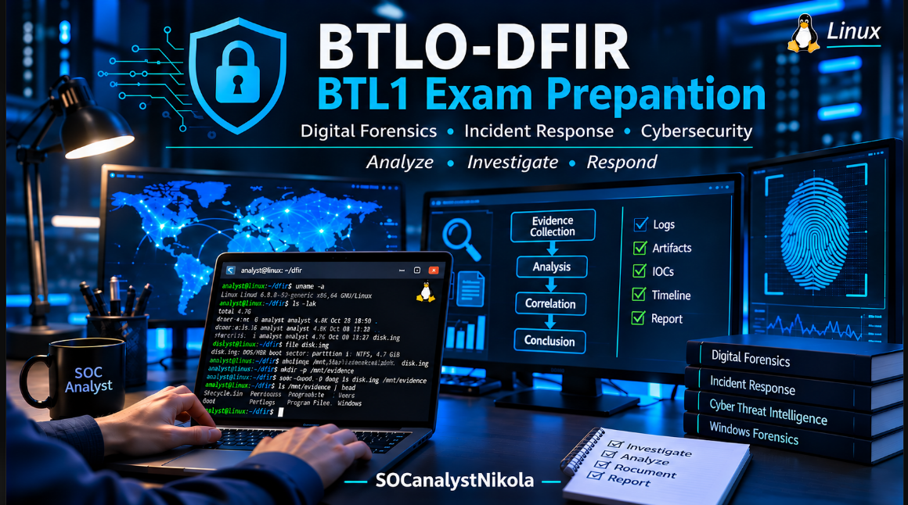

# BTLO / DFIR Challenges — BTL1 Exam Preparation

## Overview

This repository documents practical cybersecurity and Digital Forensics and Incident Response (DFIR) exercises completed as part of my preparation for the **Blue Team Level 1 (BTL1)** certification.

The portfolio contains structured challenge write-ups, investigation workflows, commands, screenshots, technical findings, and conclusions.

All documented exercises were performed in a **Linux** environment.

## Learning Objectives

- Develop practical Blue Team and SOC analyst skills.
- Improve malware analysis and reverse engineering capabilities.
- Practice digital forensic investigation techniques.
- Understand suspicious activity and identify relevant indicators.
- Document investigation procedures and technical findings.
- Build practical knowledge relevant to the BTL1 certification.

## Areas of Focus

- Digital Forensics and Incident Response (DFIR)
- Malware Analysis
- Static Analysis and Reverse Engineering
- Network Traffic Analysis
- Windows Artifacts and Event Logs
- PowerShell Analysis
- Security Monitoring and Investigation
- Phishing and Suspicious File Analysis

## Lab Environment

| Component | Description |
|---|---|
| Operating System | Linux |
| Training Platform | Blue Team Labs Online (BTLO) |
| Focus | Blue Team / SOC / DFIR |
| Purpose | BTL1 Certification Preparation |

## Documented Challenges

| Challenge | Category | Documentation |
|---|---|---|
| ATT&CK | Threat Intelligence / MITRE ATT&CK | [View Challenge](challenges/attack/README.md) |
| Barcode World | Miscellaneous / Data Decoding | [View Challenge](challenges/barcode-world/README.md) |
| Classical City | Cryptography / Classical Ciphers | [View Challenge](challenges/classical-city/README.md) |
| D3FEND | Defensive Framework / Threat Detection | [View Challenge](challenges/d3fend/README.md) |
| Follina - CVE-2022-30190 | Malware Analysis | [View Challenge](challenges/follina/README.md) |
| Injection Series Part 3 | Malware Analysis / Reverse Engineering | [View Challenge](challenges/injection-series-part-3/README.md) |
| Log Analysis - Compromised WordPress | Log Analysis / Web Application Security | [View Challenge](challenges/log-analysis-compromised-wordpress/README.md) |
| Log Analysis - Privilege Escalation | Log Analysis / Linux Privilege Escalation | [View Challenge](challenges/log-analysis-privilege-escalation/README.md) |
| Log Analysis - Sysmon | Log Analysis / Malware Analysis | [View Challenge](challenges/log-analysis-sysmon/README.md) |
| Malicious PowerShell Analysis | Malware Analysis / PowerShell Analysis | [View Challenge](challenges/malicious-powershell-analysis/README.md) |
| Malware Analysis - Phishing Analysis | Malware Analysis / Email Phishing | [View Challenge](challenges/malware-analysis-phishing-analysis/README.md) |
| Malware Analysis - Ransomware Script | Malware Analysis | [View Challenge](challenges/malware-analysis-ransomware-script/README.md) |
| Phishing Analysis 2 | Malware Analysis / Email Phishing | [View Challenge](challenges/malware-analysis-phishing-analysis-2/README.md) |
| Memory Analysis - Ransomware | Memory Forensics / Malware Analysis | [View Challenge](challenges/memory-analysis-ransomware/README.md) |
| Meta | Challenge Preparation / File Analysis | [View Challenge](challenges/meta/README.md) |
| Network Analysis - Malware Compromise | Network Analysis / Malware Analysis | [View Challenge](challenges/network-analysis-malware-compromise/README.md) |
| Network Analysis - Web Shell | Network Analysis / Web Shell Investigation | [View Challenge](challenges/network-analysis-web-shell/README.md) |
| Reverse Engineering - A Classic Injection | Malware Analysis / Reverse Engineering | [View Challenge](challenges/reverse-engineering-a-classic-injection/README.md) |
| Reverse Engineering - Another Injection | Malware Analysis / Reverse Engineering | [View Challenge](challenges/reverse-engineering-another-injection/README.md) |
| Secure Shell | Network Security / SSH | [View Challenge](challenges/secure-shell/README.md) |
| Squid Game | Miscellaneous / Challenge Investigation | [View Challenge](challenges/squid-game/README.md) |
| Suspicious USB Stick | Digital Forensics / Malware Analysis | [View Challenge](challenges/suspicious-usb-stick/README.md) |
| The Report | Threat Intelligence / Threat Detection | [View Challenge](challenges/the-report/README.md) |
| The Report II | SOC Operations / SOC Strategy | [View Challenge](challenges/the-report-ii/README.md) |

## Documentation Approach

Each challenge is documented using a consistent structure where applicable:

- Challenge overview and objectives
- Lab environment and tools
- Investigation methodology
- Commands and technical analysis
- Findings and answers
- Screenshots and supporting evidence
- Conclusion and BTL1 learning relevance

## Disclaimer

This repository is intended for educational purposes and practical cybersecurity skill development.

All activities are performed in controlled lab environments. The documented techniques and tools are used for defensive security, forensic investigation, and learning.

---

**Portfolio:** BTLO / DFIR Challenges — BTL1 Exam Preparation
