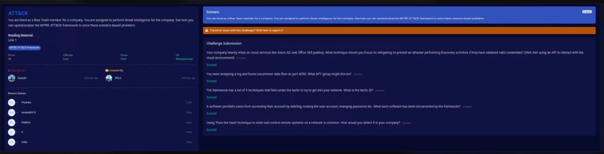

# ATT&CK

## Challenge Information

| Field | Details |
|---|---|
| Challenge | ATT&CK |
| Category | Threat Intelligence / MITRE ATT&CK |
| Platform | Blue Team Labs Online (BTLO) |
| Environment | Linux |
| Primary Resource | MITRE ATT&CK |
| Investigation Type | Framework research and threat intelligence |
| Evidence | Original challenge screenshot and saved investigation notes |

## Overview

This challenge focused on using the MITRE ATT&CK framework to identify adversary techniques, tactics, software and threat groups.

The investigation was performed through the MITRE ATT&CK website. No terminal-based analysis or local execution was required.

The objective was to interpret five security-related questions, identify the relevant ATT&CK entries and retrieve their corresponding identifiers or detection guidance.

## Evidence

The documentation is based on:

- Original BTLO challenge notes.
- Screenshot_13.png, preserved in the `images` directory.
- MITRE ATT&CK as the primary reference identified in the original investigation notes.

The screenshot was copied from the original evidence directory. Its SHA256 hash was checked after copying to confirm file integrity.

## Investigation Methodology

### 1. Identify relevant keywords

Each question was reviewed to identify the main security concept, such as Cloud Discovery, port 4050, Initial Access, account locking or Pass the Hash.

### 2. Search the MITRE ATT&CK framework

The MITRE ATT&CK website was used as the primary reference:

https://attack.mitre.org/

Relevant techniques, tactics, software entries and threat group profiles were located through the website search and framework pages.

### 3. Identify ATT&CK identifiers

The investigation distinguished between the main ATT&CK object types:

- Techniques: T#### or T####.###
- Tactics: TA####
- Software: S####
- Groups: G####

### 4. Review supporting descriptions

The descriptions and associated information were used to connect each question with the corresponding ATT&CK entry.

### 5. Record answers and detection guidance

The identified IDs and the detection wording were recorded in the challenge notes.

## Questions and Answers

### Q1 - Cloud Discovery Mitigation

**Question:** Which technique should be considered when mitigating an attacker using valid credentials to perform discovery through a cloud service dashboard rather than an API?

**Answer:** `T1538` - Cloud Service Dashboard.

**Explanation:**

This technique describes an adversary using a cloud service's web interface or dashboard to obtain information about the cloud environment. An attacker with valid credentials may use the graphical interface to discover resources and configuration details.

### Q2 - Port 4050 and APT Group

**Question:** Which APT group might be associated with unusual data flow observed on port 4050?

**Answer:** `G0099` - APT-C-36 (Blind Eagle).

**Explanation:**

The original investigation notes associate APT-C-36 with the use of port 4050 for command-and-control communication.

An unusual port number alone is not sufficient to attribute activity to a threat group. Network context and additional indicators are required.

### Q3 - Initial Access Tactic

**Question:** Which tactic ID corresponds to the tactic containing nine techniques intended to provide an initial entry into a network?

**Answer:** `TA0001` - Initial Access.

**Explanation:**

Initial Access represents the adversary's objective of gaining an initial foothold in a target environment.

The reference to nine techniques reflects the older framework version used when the challenge was prepared. The number of techniques can change as MITRE ATT&CK is updated.

### Q4 - Software That Locks User Accounts

**Question:** Which software documented by the framework can prevent users from accessing their accounts through account deletion, account locking or password changes?

**Answer:** `S0372` - LockerGoga.

**Explanation:**

LockerGoga is ransomware documented in MITRE ATT&CK. The challenge notes associate it with actions that can prevent users from accessing their accounts.

### Q5 - Pass the Hash Detection

**Question:** How can an organization detect Pass the Hash activity when attackers use this technique to access and control remote systems?

**Answer:**

> Monitor newly created logons and credentials used in events and review for discrepancies.

**Explanation:**

The detection guidance focuses on monitoring newly created logon events and the credentials associated with those events. Reviewing discrepancies can help identify suspicious authentication activity.

Pass the Hash is technique `T1550.002`, under the broader Use Alternate Authentication Material technique.

## Answer Summary

| Question | Subject | Answer |
|---|---|---|
| Q1 | Cloud Service Dashboard | T1538 |
| Q2 | Port 4050 APT group | G0099 - APT-C-36 |
| Q3 | Initial Access tactic | TA0001 |
| Q4 | Account-locking software | S0372 - LockerGoga |
| Q5 | Pass the Hash detection | Monitor newly created logons and credentials used in events and review for discrepancies |

## Key Indicators and ATT&CK References

| Identifier | Name | Object Type |
|---|---|---|
| T1538 | Cloud Service Dashboard | Technique |
| G0099 | APT-C-36 | Group |
| TA0001 | Initial Access | Tactic |
| S0372 | LockerGoga | Software |
| T1550.002 | Pass the Hash | Sub-technique |

## Tools and Resources

| Resource | Purpose |
|---|---|
| MITRE ATT&CK website | Primary source for techniques, tactics, groups and software |
| MITRE ATT&CK search | Locate entries using keywords and identifiers |
| Google Search | Supplementary research when locating references such as port 4050 |
| Browser | Review framework descriptions and associated information |

No terminal commands were required for this challenge.

## DFIR Findings

The challenge demonstrated how the MITRE ATT&CK framework can be used to connect observed or suspected adversary behavior with documented tactics, techniques, software and threat groups.

The five questions covered:

- Cloud environment discovery through a service dashboard.
- Threat group research using a network port as an investigative lead.
- The Initial Access tactic.
- Ransomware-related account access disruption.
- Detection guidance for Pass the Hash activity.

ATT&CK identifiers provide a consistent vocabulary for documenting adversary behavior and supporting detection engineering.

## Limitations and Evidence Notes

- The answers in this document were transcribed from the original challenge notes.
- The original investigation was not independently repeated against the current MITRE ATT&CK website during repository preparation.
- ATT&CK content is updated over time. Technique counts and descriptions may differ from the version used when the challenge was created.
- Port 4050 by itself cannot establish attribution to APT-C-36.
- The presence of a technique or software entry in ATT&CK does not prove that the behavior occurred in a particular environment.
- The Pass the Hash detection statement is reproduced from the original challenge notes and should be validated against current detection requirements before operational deployment.

## Learning Outcomes

This challenge provided practical experience in:

- Navigating the MITRE ATT&CK knowledge base.
- Distinguishing tactics, techniques, software and threat groups.
- Mapping security observations to ATT&CK identifiers.
- Using ATT&CK as a reference for threat intelligence and detection engineering.
- Understanding why framework version changes matter when interpreting older investigation material.

## Conclusion

The ATT&CK challenge demonstrated the value of a structured adversary knowledge base in security operations and incident investigation.

Correctly identifying ATT&CK objects helps analysts describe adversary behavior consistently, communicate findings and develop detection strategies.

## Screenshot

