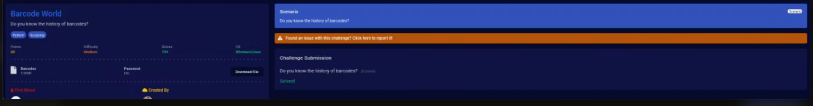
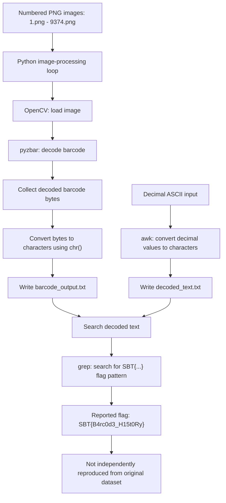

# Barcode World

## Challenge Information

| Field | Details |
|---|---|
| Challenge | Barcode World |
| Platform | Blue Team Labs Online (BTLO) |
| Category | Miscellaneous / Data Decoding |
| Environment | Linux |
| Primary Tools | Python 3, OpenCV, pyzbar, awk, grep |
| Evidence Screenshot | `images/Screenshot_28.png` |
| Objective | Decode barcode images and recover the challenge flag |

## Overview

Barcode World is a data-decoding challenge involving a collection of numbered image files. The investigation notes describe using Python, OpenCV and pyzbar to read barcode content, followed by text conversion and searching for the expected flag format.

The documented workflow processes images named from `1.png` through `9374.png`, combines decoded barcode data and searches the resulting text for a flag.

The original investigation notes report the following flag:

**Flag:** `SBT{B4rc0d3_H15t0Ry}`

The original image dataset and generated output files were not independently re-acquired for this repository documentation. The answer is therefore recorded as reported in the original notes.

## Evidence

The following evidence is included in this repository:

- `images/Screenshot_28.png` - Screenshot of the Barcode World challenge.
- Original investigation notes - Used as the source for the documented workflow and reported answer.

The screenshot was copied from the original evidence directory. Its SHA256 hash was compared with the source file and both values matched:

| File | SHA256 |
|---|---|
| Screenshot_28.png | `36E6B0AB3235ED984733BB6D62ECA6D2A9A7898972E9B197B10F801FD7EAF6A6` |

## Investigation Methodology

### 1. Prepare the Linux environment

The investigation notes specify the following system packages:

```bash
sudo apt update
sudo apt install zbar-tools python3-pip python3-venv -y
```

Create an isolated Python environment:

```bash
cd ~/Downloads/Barcode_World
python3 -m venv barcode-env
source barcode-env/bin/activate
```

Install the required Python libraries:

```bash
pip install pyzbar opencv-python pillow
```

Using a virtual environment avoids installing Python packages into the system-managed Python environment and helps address Linux PEP 668 restrictions.

### 2. Decode barcode images

The notes describe a Python script using OpenCV and pyzbar.

The relevant processing logic is:

```python
import cv2
from pyzbar.pyzbar import decode
import os

folder = os.path.expanduser("~/Downloads/Barcode_World")
barcode_data = []

for i in range(1, 9375):
    image_path = os.path.join(folder, f"{i}.png")
    image = cv2.imread(image_path)

    if image is None:
        print(f"[!] Image not found: {image_path}")
        continue

    decoded = decode(image)

    for barcode in decoded:
        barcode_data.extend(barcode.data)

result_text = "".join(chr(b) for b in barcode_data)

with open("barcode_output.txt", "w") as f:
    f.write(result_text)

print(result_text)
```

The script:

1. Iterates over the numbered image files.
2. Loads each image using `cv2.imread()`.
3. Attempts barcode decoding with `pyzbar.decode()`.
4. Adds decoded barcode bytes to a collection.
5. Converts the collected byte values into characters.
6. Writes the resulting text to `barcode_output.txt`.

Missing or unreadable images are skipped and reported.

### 3. Convert decimal ASCII values into text

The original notes also document an `awk` conversion:

```bash
awk '{for(i=1;i<=NF;i++) printf "%c", $i}' barcode_output.txt > decoded_text.txt
```

This command converts whitespace-separated decimal ASCII values into characters using `printf "%c"`.

**Important technical distinction:** The Python logic shown above already converts barcode bytes into characters before writing `barcode_output.txt`. The `awk` command, however, expects that file to contain decimal ASCII values. These are two different data representations. The original notes do not establish that the `awk` command was executed against the output of the shown Python script without an intermediate transformation.

Therefore, the ASCII conversion step is documented as a separate method from the Python byte-to-text conversion, not as a verified continuation of the same output.

### 4. Search the decoded content

The notes specify the following commands:

```bash
head -20 decoded_text.txt
grep -oE "SBT\{[^}]+\}" decoded_text.txt
grep -i "flag" decoded_text.txt
```

Purpose:

- `head -20` displays the first 20 lines.
- `grep -oE` searches for strings matching the expected `SBT{...}` format.
- `grep -i` searches for the word `flag`, ignoring case.

The original notes report the following extracted text:

```text
This is the flag - B4rc0d3_H15t0Ry
```

Reported challenge answer:

```text
SBT{B4rc0d3_H15t0Ry}
```

## Questions and Answers

| Question | Reported Answer |
|---|---|
| Do you know the history of barcodes? | `SBT{B4rc0d3_H15t0Ry}` |

The answer is transcribed from the original challenge notes and has not been independently verified against the complete barcode dataset.

## Tools and Resources

| Tool | Purpose |
|---|---|
| Python 3 | Automating barcode processing |
| OpenCV | Loading image files |
| pyzbar | Decoding barcode content |
| zbar-tools | Barcode utilities |
| awk | Converting decimal ASCII values into characters |
| grep | Searching for flag patterns and keywords |
| sed | Removing trailing carriage-return characters |
| Python venv | Isolating Python dependencies |

### Relevant Python concepts

- `cv2.imread()` - Loads an image into memory.
- `decode()` - Attempts to identify and decode barcodes.
- `barcode.data` - Contains decoded barcode data as bytes.
- `barcode_data.extend()` - Adds decoded byte values to a collection.
- `chr()` - Converts an integer code point into a character.

## Barcode Format Reference

The original notes include the following general barcode reference:

| Format | General Characteristics |
|---|---|
| Code 39 | Alphanumeric encoding; commonly uses asterisks as start and stop delimiters |
| Code 128 | Compact alphanumeric barcode format |
| EAN-13 | Retail barcode containing 13 digits |
| UPC-A | Retail barcode containing 12 digits |
| QR Code | Two-dimensional, square barcode format |

These are general reference characteristics. The exact barcode formats present in the challenge dataset were not independently established.

## DFIR Findings

The documented investigation demonstrates a workflow for processing a large collection of image files and extracting embedded data.

Key findings from the original notes:

- The challenge dataset was described as containing 9,374 numbered PNG images.
- Barcode decoding was automated with Python, OpenCV and pyzbar.
- The decoded data was intended to be assembled into readable text.
- ASCII conversion and text searching were documented as additional analysis techniques.
- The reported flag was `SBT{B4rc0d3_H15t0Ry}`.

The workflow illustrates how information embedded in image-based data can be recovered through automated processing and text analysis.

## Limitations and Evidence Notes

- The original barcode image dataset was not included in the repository.
- The Python script and reported output were transcribed from the original investigation notes.
- The reported flag was not independently reproduced from the original images.
- The relationship between the Python-generated text output and the separate decimal-ASCII `awk` conversion requires clarification.
- The exact barcode formats and the number of successfully decoded images were not independently verified.
- The screenshot confirms the challenge identity but does not independently prove the decoding results.

These limitations distinguish documented challenge answers from independently verified forensic findings.

## Learning Outcomes

This challenge provides practical experience with:

- Automating image processing with Python.
- Loading image files with OpenCV.
- Decoding barcode data with pyzbar.
- Working with byte arrays and character conversion.
- Understanding decimal ASCII representation.
- Using `awk` for text transformation.
- Searching extracted content with `grep`.
- Managing Python dependencies in Linux with virtual environments.

## Conclusion

Barcode World demonstrates a practical data-decoding workflow that combines image processing, barcode recognition, byte handling and text analysis.

The original notes report the flag `SBT{B4rc0d3_H15t0Ry}`. The repository preserves the documented methodology and challenge screenshot while explicitly identifying the evidence that was not independently reproduced.

## Screenshot



## Barcode Analysis Workflow


