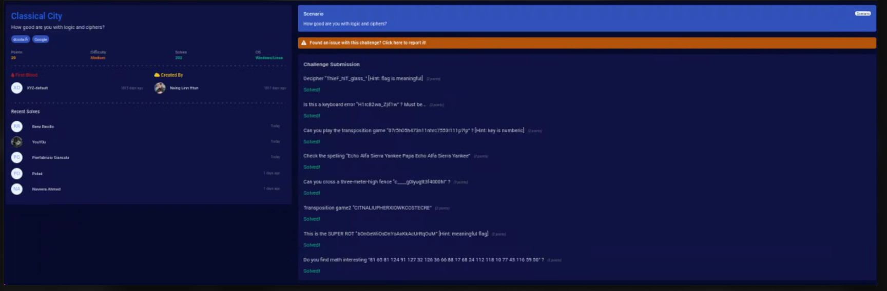

# Classical City

## Challenge Information

| Field | Details |
|---|---|
| Challenge | Classical City |
| Category | Cryptography / Classical Ciphers |
| Platform | Blue Team Labs Online (BTLO) |
| Environment | Linux |
| Questions | 8 |
| Completion Date | 23 September 2026 |
| Screenshot | `images/Screenshot_27.png` |

## Overview

Classical City is a cryptography challenge focused on recognizing and decoding several classical cipher techniques and text-encoding transformations.

The investigation involves identifying the likely cipher from the structure of the input, interpreting the hints provided in each question, and applying the appropriate decoding method.

The challenge was documented as part of practical BTLO exercises performed using Linux.

## Evidence

The following screenshot is associated with this challenge:

- `images/Screenshot_27.png`

The screenshot was copied from the original challenge evidence directory. Its SHA256 hash was checked against the source file.

| File | SHA256 |
|---|---|
| Screenshot_27.png | `6CBF8351BAA4B9A055801AA5E4F8FADFA273F494B8A6FF700B757ABCE99AF08E` |

## Investigation Methodology

The original notes describe an approach based primarily on manual reasoning and online decoding tools.

The investigation process can be summarized as follows:

1. Inspect the encoded string and identify recognizable patterns.
2. Read the challenge hint and determine which cipher or encoding may be relevant.
3. Select an appropriate decoding method.
4. Apply the transformation using dCode.fr, CyberChef, or manual analysis.
5. Compare the resulting text with the expected flag format.
6. Record the result and the decoding method.

No dedicated Linux command-line workflow was required by the original notes. The challenge was solved using browser-based tools and manual analysis.

## Questions and Answers

### Q1 - Transposition Cipher

**Input:**
`ThieF_hIT_glass_`

**Hint:** The flag is meaningful.

**Method:**
A transposition cipher rearranges the positions of characters. The original notes describe manually rearranging the letters until a meaningful phrase is obtained.

**Recorded result:**
`This_Is_The_Flag`

**Answer:**
`SBT{This_Is_The_Flag}`

### Q2 - Keyboard Shift Cipher

**Input:**
`H1rc82wa_Z|if1w`

**Hint:** Is this a keyboard error?

**Method:**
The original notes identify a Keyboard Shift Cipher and recommend the dCode.fr Keyboard Shift Cipher tool. The described approach shifts each character by two positions on a QWERTY keyboard.

**Tool:**
https://www.dcode.fr/keyboard-shift-cipher

**Answer recorded in the original notes:**
`SBT{K3yb04rd_C|ph3r}`

### Q3 - Leet Speak and Transposition

**Input:**
`07r5h05h473n11nhrc7553!111p7!p`

**Hint:** The key is numeric.

**Method:**

1. Apply Leet Speak conversion using CyberChef.
2. Use the Transposition Cipher tool on dCode.fr.
3. Apply the numeric key indicated by the challenge.

**Tools:**
- CyberChef - From Leet Speak
- https://www.dcode.fr/transposition-cipher

**Answer:**
`SBT{7h15157h37r4n5p051710ncyph3r!!}`

### Q4 - NATO Phonetic Alphabet

**Input:**
`Echo Alfa Sierra Yankee Papa Echo Alfa Sierra Yankee`

**Method:**
Translate each NATO phonetic alphabet word into its corresponding letter.

| Word | Letter |
|---|---|
| Echo | E |
| Alfa | A |
| Sierra | S |
| Yankee | Y |
| Papa | P |

**Decoded text:**
`EASY_PEASY`

**Answer:**
`SBT{EASY_PEASY}`

### Q5 - Rail Fence Cipher

**Input:**
`c____g0lyugtt3f4000hi`

**Hint:** A three-meter-high fence.

**Method:**
The hint indicates a Rail Fence Cipher with three rails. The original notes recommend removing the placeholder underscores before entering the ciphertext into the decoder.

**Tool:**
https://www.dcode.fr/rail-fence-cipher

**Recorded input for the decoder:**
`cg0lyugtt3f4000hi`

**Key:**
`3`

**Answer:**
`SBT{c00l_y0u_g0t_th3_fl4g}`

### Q6 - Transposition Cipher (Second Variant)

**Input:**
`CITNALIUPHERXIOWKCOSTECRE`

**Method:**
Use the Transposition Cipher decoder on dCode.fr to identify the rearrangement that produces the expected plaintext.

**Tool:**
https://www.dcode.fr/transposition-cipher

**Answer:**
`SBT{ANTICLOCKWISEROUTECIPHERX}`

### Q7 - ROT Cipher

**Input:**
`bOnGeWiOsDnYoAxKkAcUrRqOuM`

**Hint:** The flag is meaningful.

**Method:**
The original notes recommend testing ROT transformations, particularly ROT13, using the dCode.fr ROT Cipher tool.

**Tool:**
https://www.dcode.fr/rot-cipher

**Answer recorded in the original notes:**
`{sEcUrItYbLuEtEaMlAbSoNlInE}`

**Evidence note:**
The recorded answer does not contain the usual `SBT{...}` wrapper. It is preserved exactly as written in the source notes and has not been independently verified.

### Q8 - ASCII Values with an Offset

**Input:**
`81 65 81 124 91 127 32 126 36 66 88 17 68 24 112 118 10 77 43 116 59 50`

**Hint:** Mathematical reasoning.

**Method:**
The original notes describe the input as ASCII values with an offset. The suggested approach is to identify and subtract the appropriate constant offset before interpreting the resulting values as characters.

**Tool:**
https://www.dcode.fr/ascii-code

**Answer:**
`SBT{Pr1m3_y4m3_C1ph3r}`

## Tools and Resources

| Tool | Purpose |
|---|---|
| dCode.fr | Classical cipher decoding and analysis |
| CyberChef | Leet Speak, ASCII, Base64 and data transformations |
| NATO Phonetic Alphabet | Translating phonetic words into letters |
| Manual analysis | Recognizing patterns and testing possible transformations |

Useful resources:

- https://www.dcode.fr
- https://gchq.github.io/CyberChef/
- https://www.dcode.fr/keyboard-shift-cipher
- https://www.dcode.fr/transposition-cipher
- https://www.dcode.fr/rail-fence-cipher
- https://www.dcode.fr/rot-cipher
- https://www.dcode.fr/ascii-code

## DFIR Findings

Although this is a cryptography-focused challenge rather than a conventional incident-response investigation, several analytical skills are relevant to security operations:

- Recognizing encoded or transformed strings.
- Distinguishing substitution, transposition, and encoding techniques.
- Using hints to narrow down possible decoding methods.
- Applying multiple transformations in sequence.
- Preserving original evidence and recording the method used to interpret it.

The challenge also demonstrates why an analyst should not assume that every unusual string is Base64, hexadecimal, or another common encoding. The structure and context of the data are important.

## Limitations and Evidence Notes

- The original TXT notes were used as the primary source for the recorded questions, methods, and answers.
- The original challenge dataset and independent decoding outputs were not available for this documentation step.
- The answers have not been independently reproduced from the original challenge inputs.
- Q1, Q3, and Q6 are described as transposition-based, but the exact cipher parameters and intermediate outputs are not preserved in the source notes.
- Q2 is documented as a two-position keyboard shift; the exact keyboard layout and direction were not independently verified.
- Q5 is documented with three rails; the original notes mention removing underscores from the input before decoding.
- Q7 is preserved exactly as recorded because its output does not follow the usual flag wrapper.
- Q8 does not include the intermediate offset calculation in the original notes.
- The screenshot establishes the challenge reference but does not independently validate every recorded answer.

## Learning Outcomes

By completing this challenge, the analyst practices:

1. Recognizing classical cipher patterns.
2. Understanding transposition and rotation techniques.
3. Working with keyboard-shift transformations.
4. Decoding NATO phonetic alphabet strings.
5. Applying Rail Fence cipher techniques.
6. Recognizing Leet Speak substitutions.
7. Interpreting ASCII values and offsets.
8. Documenting decoding methodology and evidence limitations.

## Conclusion

Classical City provides practical exposure to several classical cryptographic techniques and demonstrates the importance of pattern recognition, contextual reasoning, and systematic testing.

The documented answers and procedures are based on the original challenge notes. Independent reproduction of the complete decoding process remains outside the scope of this documentation.

## Screenshot

