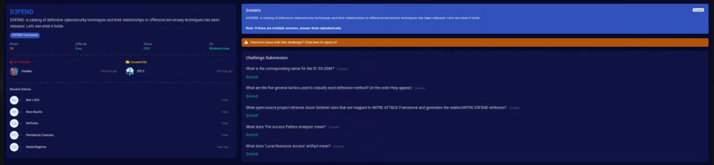

# D3FEND

## Challenge Information

| Field | Details |
|---|---|
| Challenge | D3FEND |
| Category | Defensive Framework / Threat Detection |
| Platform | Blue Team Labs Online (BTLO) |
| Environment | Kali Linux / Web-based research |
| Evidence | Original challenge notes and screenshot |
| Screenshot | `images/Screenshot_6.png` |

## Overview

This challenge explores the MITRE D3FEND knowledge base, a framework that describes defensive cybersecurity techniques and their relationships to adversary behaviors.

The investigation focused on identifying defensive techniques, understanding the framework's general tactical categories, locating a related open-source project, and interpreting selected D3FEND definitions.

The answers and investigation steps documented here are based on the original challenge notes. They have not all been independently reproduced.

## Evidence

The following materials were used to prepare this documentation:

- Original challenge notes: `BTLO CRT Challenge - D3FEND.txt`
- Original challenge screenshot: `Screenshot_6.png`
- MITRE D3FEND technique documentation
- Sentinel2D3FEND GitHub repository

The screenshot is included as supporting evidence of the challenge. The original source file was preserved, and the repository copy was verified using SHA256.

## Investigation Methodology

The investigation was based on documentation research and framework navigation:

1. Open the official MITRE D3FEND website.
2. Search for the technique identifier or artifact name provided in the question.
3. Review the corresponding technique or artifact page.
4. Record the official name or definition.
5. Locate the Sentinel2D3FEND project on GitHub and review its stated purpose.
6. Compare the collected information with the original challenge notes.

No malware execution, endpoint modification, or live attack simulation was required for this challenge.

## Questions and Answers

### Q1. What is the corresponding name for the ID `D3-SDM`?

**Answer:** `System Daemon Monitoring`

The original notes identify this technique through the MITRE D3FEND technique page.

Reference: [System Daemon Monitoring](https://d3fend.mitre.org/technique/d3f:SystemDaemonMonitoring/)

### Q2. What are the five general tactics used to classify each defensive method, in the order they appear?

**Answer:** `Harden, Detect, Isolate, Deceive, Evict`

These are the five general defensive tactic categories recorded in the original challenge notes.

### Q3. What open-source project retrieves Azure Sentinel rules mapped to MITRE ATT&CK and generates related MITRE D3FEND defenses?

**Answer:** `Sentinel2D3FEND`

The original notes identify the project maintained in the Intellisec-Solutions GitHub repository.

Reference: [Intellisec-Solutions/Sentinel2D3FEND](https://github.com/Intellisec-Solutions/Sentinel2D3FEND)

### Q4. What does File Access Pattern Analysis mean?

**Answer:** `Analyzing the files accessed by a process to identify unauthorized activity.`

The notes associate this explanation with the D3FEND File Access Pattern Analysis technique.

Reference: [File Access Pattern Analysis](https://d3fend.mitre.org/technique/d3f:FileAccessPatternAnalysis/)

### Q5. What does the Local Resource Access artifact mean?

**Answer:** `Ephemeral digital artifact comprising a request of a local resource and any response from that resource.`

The original notes state that this definition was found in D3FEND artifact documentation. The notes also indicate uncertainty about whether this question appeared in the original challenge screenshot.

Reference: [Local Resource Access](https://d3fend.mitre.org/dao/artifact/d3f:LocalResourceAccess/)

## Tools and Resources

- MITRE D3FEND: https://d3fend.mitre.org/
- MITRE ATT&CK: https://attack.mitre.org/
- Sentinel2D3FEND: https://github.com/Intellisec-Solutions/Sentinel2D3FEND
- Web browser
- D3FEND technique and artifact documentation

## DFIR Findings

The challenge demonstrates how a defensive knowledge base can be used to identify and describe defensive techniques and artifacts.

Key findings recorded in the notes:

- `D3-SDM` corresponds to System Daemon Monitoring.
- The five general tactics are Harden, Detect, Isolate, Deceive, and Evict.
- Sentinel2D3FEND is identified as an open-source project connecting Azure Sentinel detection rules mapped to ATT&CK with D3FEND defenses.
- File Access Pattern Analysis concerns examining process file-access behavior for potentially unauthorized activity.
- Local Resource Access describes an ephemeral artifact involving a request to a local resource and its response.

These framework definitions provide useful terminology for defensive analysis. Their presence in D3FEND does not by itself establish that a particular technique or behavior occurred in an investigated environment.

## Limitations and Evidence Notes

- Answers were transcribed from the original challenge notes and were not independently reproduced in a fresh challenge session.
- The original notes contain encoding artifacts; wording was normalized for readability in this README.
- The fifth question is retained because it appears in the notes, but its presence in the original challenge screenshot is uncertain.
- The exact navigation steps and intermediate search results were not preserved.
- The screenshot supports challenge identification but does not independently validate every answer.
- Framework content and project documentation may change over time. References should be checked against their current versions before operational use.

## Learning Outcomes

- Navigate the MITRE D3FEND knowledge base.
- Identify defensive techniques by their D3FEND identifiers.
- Recognize the five general defensive tactic categories.
- Understand the relationship between MITRE ATT&CK detection coverage and D3FEND defensive knowledge.
- Distinguish technique definitions from evidence that a behavior actually occurred.

## Conclusion

The D3FEND challenge provided practical exposure to a structured defensive cybersecurity knowledge base and its terminology. It also introduced Sentinel2D3FEND as an example of a project that relates ATT&CK-mapped detection rules to defensive techniques.

The results documented here preserve the answers and research references from the original challenge notes, with explicit limitations where independent verification was not available.

## Screenshot

