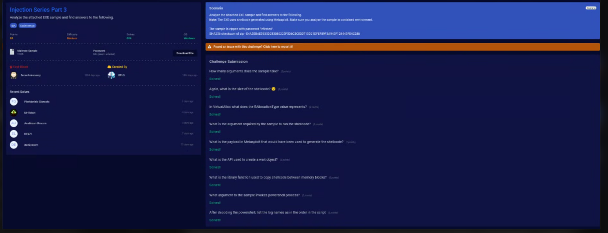
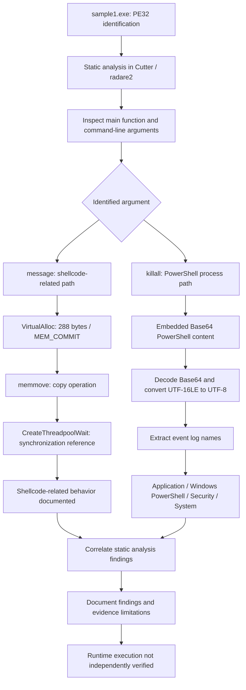

# Injection Series Part 3

## Challenge Overview

| Field | Details |
|---|---|
| Platform | Blue Team Labs Online (BTLO) |
| Challenge | Injection Series Part 3 |
| Category | Malware Analysis / Reverse Engineering |
| Environment | Linux |
| Completion Date | 28 September 2026 |
| Completion Time | 13:54 |
| Training Context | BTL1 (Blue Team Level 1) preparation |

## Objective

The objective of this challenge was to perform static analysis of a Windows PE executable (`sample1.exe`) and identify command-line arguments, shellcode characteristics, Windows API functions, and an embedded PowerShell command.

The investigation focused on the program's `main` function and its use of memory allocation, shellcode-related operations, synchronization APIs, and process execution.

## Environment and Tools

All documented practical work was performed using Linux.

| Tool | Purpose |
|---|---|
| Cutter | GUI-based static analysis |
| radare2 | Command-line binary analysis |
| `file` | Executable file identification |
| `base64` | Base64 decoding |
| `iconv` | Character encoding conversion |
| CyberChef | Alternative data decoding |
| Web research | Verification of Windows API constants and Metasploit references |

## Investigation Workflow

### 1. Initial File Identification

```bash
cd ~/Downloads
file sample1.exe
sudo apt install cutter -y
```

The `file` command was used to identify the executable format. The original notes identify the sample as a PE32 executable.

### 2. Static Analysis with Cutter

```bash
cutter sample1.exe
```

The `main` function was located in Cutter's function list and inspected.

The analysis focused on:

- Command-line argument checks
- Windows API calls
- Memory allocation parameters
- Shellcode-related operations
- Embedded strings and encoded PowerShell content

### 3. Alternative Analysis with radare2

```bash
r2 -A sample1.exe
```

The following command was used to search for potentially relevant functions:

```bash
afl | grep -iE "Wait|mem|VirtualAlloc"
```

This provides an alternative command-line method for locating functions of interest.

### 4. Base64 PowerShell Decoding

The embedded Base64-encoded PowerShell command was decoded using:

```bash
echo "YOUR_BASE64_STRING" | base64 -d | iconv -f UTF-16LE -t UTF-8
```

The decoded content revealed the following Windows event log names, in script order:

1. Application
2. Windows PowerShell
3. Security
4. System

CyberChef was also available as an alternative:

https://gchq.github.io/CyberChef/

## Technical Analysis

### Memory Allocation

The analysis notes identify a `VirtualAlloc` call with a size parameter of:

```text
0x120 = 288 bytes
```

The allocation type parameter was identified as:

```text
0x1000 = MEM_COMMIT
```

`MEM_COMMIT` commits memory pages within a process's virtual address space. It does not mean that the pages are immediately resident in physical RAM.

### Shellcode Handling

The analysis identified `memmove` as the library function used to copy data between memory regions.

The sample also references `CreateThreadpoolWait`, a Windows API function used to create a thread-pool wait object for synchronization.

### Command-Line Arguments

Two relevant arguments were identified in the program's command-line checks:

- `message` — associated with the shellcode execution path.
- `killall` — associated with the PowerShell process execution path.

### Metasploit Payload Reference

The recorded analysis identified the following Metasploit payload:

```text
windows/messagebox
```

This payload is associated with shellcode that displays a Windows message box. The identification is an analytical conclusion from the challenge notes; the `message` argument alone does not independently prove which payload generated the shellcode.

## Questions and Answers

| # | Question | Answer |
|---:|---|---|
| 1 | How many arguments does the sample take? | `1` |
| 2 | What is the size of the shellcode? | `288` |
| 3 | What does the `flAllocationType` value in `VirtualAlloc` represent? | `MEM_COMMIT` |
| 4 | What argument is required by the sample to run the shellcode? | `message` |
| 5 | What Metasploit payload would have been used to generate the shellcode? | `windows/messagebox` |
| 6 | What API is used to create a wait object? | `CreateThreadpoolWait` |
| 7 | What library function is used to copy shellcode between memory blocks? | `memmove` |
| 8 | What argument invokes the PowerShell process? | `killall` |
| 9 | List the log names in the order found in the decoded PowerShell script. | `Application`, `Windows PowerShell`, `Security`, `System` |

**Note:** The answer to Question 1 represents one user-supplied command-line argument, excluding the executable name.

## Windows API Reference

| Function | Purpose | Relevance |
|---|---|---|
| `VirtualAlloc` | Reserves or commits virtual memory pages | Memory allocation |
| `CreateThreadpoolWait` | Creates a thread-pool wait object | Synchronization |
| `memmove` | Copies data between memory regions | Memory operations |
| `CreateProcess` | Creates a new process | Process execution |
| `Sleep` | Suspends execution for a specified interval | Potential timing or delay behavior |

This is a general API reference. The presence of a function in this table does not independently establish that it was observed in the sample.

## Key Findings

- The original notes identify the executable as a PE32 Windows sample.
- The argument `message` is associated with the shellcode-related execution path.
- The recorded shellcode allocation size is 288 bytes.
- The `VirtualAlloc` allocation type is `MEM_COMMIT` (`0x1000`).
- `CreateThreadpoolWait` and `memmove` were identified as relevant functions.
- The argument `killall` was associated with the PowerShell execution path.
- Decoding the embedded PowerShell command revealed four Windows event log names.

## Skills Demonstrated

- Static analysis of Windows PE executables
- Function navigation and code inspection in Cutter
- Command-line binary analysis with radare2
- Recognition of Windows memory allocation constants
- Identification of Windows API functions
- Analysis of shellcode-related operations
- Base64 decoding of PowerShell content
- UTF-16LE to UTF-8 conversion
- Structured technical documentation

## BTL1 Preparation Relevance

This challenge supports practical blue-team skills in malware analysis, static inspection of Windows executables, recognition of potentially suspicious API usage, and analysis of encoded PowerShell content.

These techniques help analysts understand executable behavior and identify evidence that may be relevant during incident response.

## Evidence

The screenshot below documents the corresponding challenge.



## Conclusion

This exercise provided practical experience in examining a Windows executable, identifying shellcode-related functionality, interpreting Windows API parameters, and decoding embedded PowerShell content.

It reinforced the importance of examining program logic, validating API parameters, and distinguishing observed evidence from analytical conclusions.

All practical work documented in this challenge was performed using Linux as part of BTL1 preparation.


## Static Malware Analysis and Execution Flow


