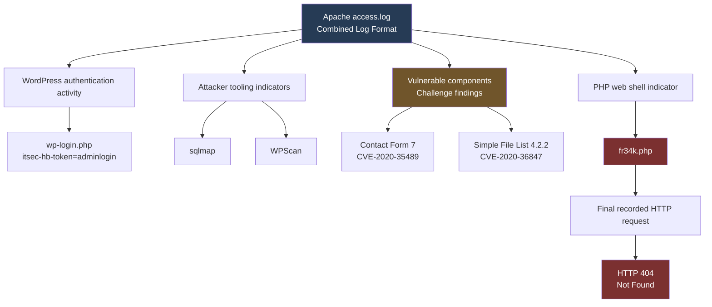

# Log Analysis - Compromised WordPress

## Challenge Information

- **Platform:** Blue Team Labs Online (BTLO)
- **Category:** Log Analysis / Web Application Security
- **Environment:** Linux
- **Primary Evidence:** Apache `access.log`
- **Focus:** WordPress compromise, web application exploitation, attacker tooling, and web shell activity
- **Completion Date:** 24 September 2026

## 1. Investigation Overview

This investigation analyzes Apache access logs from a compromised WordPress website.

The objective is to identify the attacker's login path, recognize tools used during reconnaissance and exploitation, identify vulnerable WordPress components, locate the uploaded PHP web shell, and determine the HTTP response code returned during its final recorded access.

The investigation uses command-line log analysis techniques available on Linux.

## 2. Evidence and Preparation

The primary evidence file is `access.log`.

Initial inspection:

    cd ~/Downloads
    file access.log
    head -5 access.log

These commands identify the file type and display the first five log entries to establish the log format.

The challenge notes identify the log as Apache Combined Log Format.

## 3. Investigation Methodology

### 3.1 Identify the Admin Login URI

Command:

    grep -i "wp-login" access.log | head -20

This searches for WordPress login-related requests and displays the first 20 matching entries.

The relevant URI contains the `itsec-hb-token` parameter.

**Finding:**

    /wp-login.php?itsec-hb-token=adminlogin

### 3.2 Identify Attacker Tools

Command:

    awk -F'"' '{print $6}' access.log | sort -u | grep -iE "sqlmap|wpscan|nikto|nmap|hydra|python|curl|wget"

The command splits each log entry at quotation marks. In the expected Combined Log Format, the sixth field produced by this delimiter is the User-Agent value.

The output is filtered for common security and reconnaissance tools.

**Finding:**

- sqlmap
- WPScan

These tool names were identified in the User-Agent information recorded in the challenge logs.

### 3.3 Investigate the Contact Form 7 Vulnerability

This question requires vulnerability research rather than a direct log-processing command.

The challenge notes identify:

- **Component:** Contact Form 7
- **CVE:** CVE-2020-35489
- **Vulnerability type:** Unrestricted file upload

The CVE identification is reproduced from the original challenge investigation notes and should be treated as a challenge finding rather than an independently verified vulnerability assessment.

### 3.4 Identify the Exploited WordPress Plugin

Command:

    grep -i "plugins" access.log | cut -d "/" -f 5 | sort | uniq -c | sort -rn | head -20

This command searches requests containing plugin paths, extracts a path component, counts repeated values, and displays the most frequent results.

The path structure should be checked against actual log entries because the position of a plugin name can vary depending on the complete URI.

**Finding:**

- Plugin: Simple File List
- Version: 4.2.2
- CVE referenced in the challenge notes: CVE-2020-36847

The challenge notes identify this plugin version as the exploited component.

### 3.5 Identify the PHP Web Shell

Command:

    grep -oE "[a-zA-Z0-9_-]+\.php" access.log | sort | uniq -c | sort -rn | head -20

This extracts PHP filenames from log entries, counts their occurrences, and sorts the results by frequency.

The investigation focuses on PHP files requested from upload-related paths that are not expected WordPress core files.

**Finding:**

    fr34k.php

The challenge notes identify this file as the PHP web shell.

### 3.6 Determine the Final HTTP Response Code

Command:

    grep -i "fr34k.php" access.log | tail -5

This displays the last five log entries containing the web shell filename.

The HTTP response code appears after the request and protocol fields in the access log entry.

**Finding:**

    404

The final recorded access to the identified web shell returned HTTP 404 Not Found.

## 4. Answer Summary

| Question | Finding |
|---|---|
| Admin login URI | `/wp-login.php?itsec-hb-token=adminlogin` |
| Attacker tools | sqlmap, WPScan |
| Contact Form 7 CVE | CVE-2020-35489 |
| Exploited plugin | Simple File List 4.2.2 |
| PHP web shell | `fr34k.php` |
| Final web shell HTTP response | 404 |

## 5. Apache Access Log Field Reference

Apache Combined Log Format contains several fields that can be extracted using different delimiters.

| Field / Expression | Meaning |
|---|---|
| `$1` with whitespace-based awk | Client IP address |
| `$4` with whitespace-based awk | Timestamp field beginning with `[` |
| `$6` with whitespace-based awk | HTTP request method, URI, and protocol |
| `$7` with whitespace-based awk | HTTP response status code |
| `$9` with whitespace-based awk | User-Agent is not reliably represented by this field because it contains spaces |
| `$6` with `awk -F'"'` | User-Agent, when the expected Combined Log Format is present |

Important distinction: the meaning of an awk field depends on the delimiter. `$6` with `awk -F'"'` is not the same field as `$6` with the default whitespace delimiter.

Useful extraction examples:

    awk '{print $1}' access.log
    awk '{print $7}' access.log
    awk -F'"' '{print $6}' access.log

## 6. Consolidated Command Reference

    cd ~/Downloads
    file access.log
    head -5 access.log

    grep -i "wp-login" access.log | head -20

    awk -F'"' '{print $6}' access.log | sort -u | grep -iE "sqlmap|wpscan|nikto|nmap|hydra|python|curl|wget"

    grep -i "plugins" access.log | cut -d "/" -f 5 | sort | uniq -c | sort -rn | head -20

    grep -oE "[a-zA-Z0-9_-]+\.php" access.log | sort | uniq -c | sort -rn | head -20

    grep -i "fr34k.php" access.log | tail -5

## 7. DFIR Findings and Interpretation

The challenge evidence supports the following investigation sequence:

1. WordPress login activity was identified through a login URI containing an authentication-related token.
2. User-Agent information exposed references to sqlmap and WPScan.
3. The challenge investigation associated the Contact Form 7 component with CVE-2020-35489.
4. Simple File List 4.2.2 was identified as the exploited plugin.
5. The PHP file `fr34k.php` was identified as the web shell.
6. The final recorded request for the web shell returned HTTP 404.

This sequence provides a useful example of how web server access logs can help reconstruct attacker activity and identify potentially compromised application components.

### WordPress Compromise Investigation Flow

The diagram below summarizes the indicators identified in the challenge notes. It is an investigative overview, not a verified chronological attack timeline.

**Evidence note:** The diagram summarizes findings reproduced from the original challenge notes. The raw `access.log` was not independently re-analyzed during repository documentation. The recorded HTTP 404 response does not establish when or why the web shell became unavailable, nor does it prove successful code execution.

## 8. BTL1 Learning Outcomes

This challenge reinforces practical skills relevant to Blue Team and DFIR investigations:

- Inspecting Apache access logs on Linux.
- Understanding Apache Combined Log Format.
- Extracting fields with `awk` and `cut`.
- Searching and filtering log entries with `grep`.
- Counting and ranking repeated values with `sort` and `uniq`.
- Identifying suspicious User-Agent strings.
- Recognizing WordPress plugin exploitation indicators.
- Searching for suspicious PHP files and potential web shells.
- Interpreting HTTP response codes in an investigation timeline.
- Correlating application requests with known vulnerability information.

## 9. Limitations and Evidence Handling

This repository documentation is based on the original challenge notes and the recorded challenge results.

The original `access.log` was not independently re-acquired and re-analyzed as part of this repository documentation. Therefore:

- The answers are reproduced from the challenge investigation notes.
- The tool names and vulnerable components have not been independently validated against the original raw log file in this documentation workflow.
- A 404 response indicates that the requested resource was not found at the time of that request; it does not independently prove when or why the file became unavailable.
- Access log entries alone do not establish successful code execution or prove the full impact of a compromise.
- The CVE references and plugin version should be validated against authoritative vulnerability records during a separate investigation if required.

No live exploitation or execution of the identified PHP file was performed as part of this documentation.

## 10. Conclusion

The challenge demonstrates a practical web server log investigation involving WordPress authentication activity, automated attacker tooling, vulnerable plugins, and a suspected PHP web shell.

The analysis illustrates how simple Linux command-line utilities can extract useful indicators from Apache access logs and support a structured incident investigation.

The exercise was completed in a Linux environment as part of preparation for the Blue Team Level 1 (BTL1) certification.
