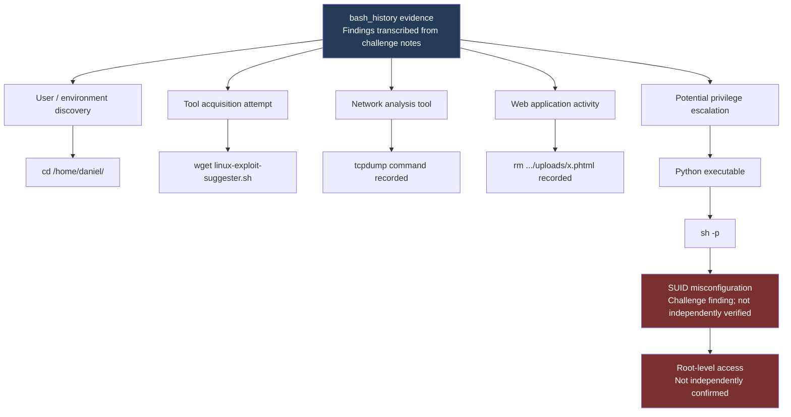
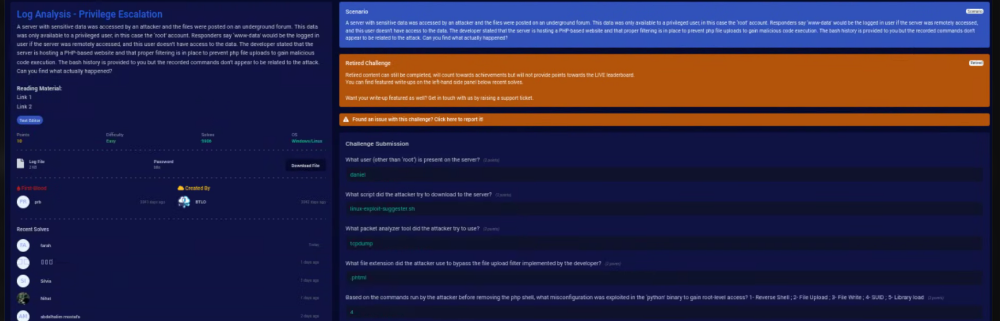

# Log Analysis - Privilege Escalation

## Challenge Information

| Field | Details |
|---|---|
| Challenge | Log Analysis - Privilege Escalation |
| Platform | Blue Team Labs Online (BTLO) |
| Category | Log Analysis / Linux Privilege Escalation |
| Environment | Kali Linux |
| Evidence | `bash_history` |
| Completion Date | 21 September 2026 |
| Purpose | BTL1 exam preparation |

## Overview

This challenge focuses on investigating a Linux shell history file to identify attacker activity, including user enumeration, script downloads, packet analysis tooling, file upload filter bypass, and a potential privilege escalation technique.

The primary evidence source is the `bash_history` file recovered from the challenge archive.

The investigation uses command history to reconstruct the sequence of commands entered by the attacker. Shell history can provide useful investigative leads, but it does not independently prove that every command executed successfully.

## Evidence

The challenge archive contains the following files:

- `bash_history` - primary command history evidence.
- `BTLO.txt` - challenge instructions.

The archive password provided by the challenge is `btlo`.

### Evidence Preparation

The archive can be extracted in Kali Linux using:

    cd ~/Downloads
    unzip -P btlo "Log File.zip"
    ls -la

The file type can be checked with:

    file bash_history

The number of recorded lines can be checked with:

    wc -l bash_history

## Investigation Methodology

The investigation uses targeted searches to identify commands associated with specific attacker activities.

### 1. Identify Local User Accounts

Search for navigation into home directories:

    grep -n "cd /home" bash_history

Relevant output:

    19: cd /home
    21: cd /home/daniel/

Finding: the history contains a reference to the `daniel` home directory.

### 2. Identify Downloaded Scripts

Search for common command-line download utilities:

    grep -n "wget\|curl" bash_history

Relevant output:

    32: wget https://raw.githubusercontent.com/mzet-/linux-exploit-suggester/master/linux-exploit-suggester.sh -O les.sh

Finding: the attacker attempted to download `linux-exploit-suggester.sh` and save it locally as `les.sh`.

### 3. Identify Packet Analysis Tools

Search for common packet analysis utilities:

    grep -n "tcpdump\|wireshark\|tshark" bash_history

Relevant output:

    47: tcpdump

Finding: `tcpdump` appears in the command history.

### 4. Identify the File Upload Extension

Inspect the final commands and search for PHP-related extensions:

    tail -5 bash_history
    grep -n "\.phtml\|\.php" bash_history

Relevant output:

    63: rm /var/www/html/uploads/x.phtml

Finding: the history references a file named `x.phtml` in the web application's uploads directory. The recorded removal command is consistent with the challenge's `.phtml` upload-filter-bypass finding.

### 5. Investigate the Python Privilege Escalation Technique

Search for Python-related commands:

    grep -n "python" bash_history

Relevant output:

    25: find / -name python*
    26: python
    27: python -c 'import pty; pty.spawn("/bin/sh")'
    62: ./usr/bin/python -c 'import os; os.execl("/bin/sh", "sh", "-p")'

The final command invokes Python to start a shell using the `-p` option.

On Linux, the `-p` option for a shell such as `sh` requests that privileged execution is preserved rather than discarded. This is consistent with an attempt to exploit a SUID-enabled Python binary.

The challenge identifies the misconfiguration as SUID.

Important: the command history is an investigative indicator. Independent confirmation of the SUID bit would require examination of the actual binary's permissions and ownership, for example with `ls -l` or `stat`.

## Questions and Answers

| ID | Question | Answer |
|---|---|---|
| Q1 | What user (other than `root`) is present on the server? | `daniel` |
| Q2 | What script did the attacker try to download to the server? | `linux-exploit-suggester.sh` |
| Q3 | What packet analyzer tool did the attacker try to use? | `tcpdump` |
| Q4 | What file extension did the attacker use to bypass the file upload filter implemented by the developer? | `.phtml` |
| Q5 | What misconfiguration was exploited in the `python` binary to gain root-level access? | `4 - SUID` |

## Consolidated Command Reference

The following commands provide a neutral approach to examining the evidence without embedding challenge answers in the search patterns.

| Command | Purpose |
|---|---|
| `file bash_history` | Identify the file type |
| `wc -l bash_history` | Count recorded lines |
| `head bash_history` | Display the first lines |
| `tail -5 bash_history` | Display the last five lines |
| `grep -n "cd /home" bash_history` | Search for home-directory navigation |
| `grep -n "wget\|curl" bash_history` | Identify download commands |
| `grep -n "tcpdump\|wireshark\|tshark" bash_history` | Search for packet analysis tools |
| `grep -n "\.phtml\|\.php" bash_history` | Search for PHP-related file extensions |
| `grep -n "python" bash_history` | Identify Python-related commands |
| `sort` | Sort text records |
| `uniq -c` | Count consecutive duplicate lines |
| `awk` | Extract selected fields |

## DFIR Findings

The command history provides indicators of several activities:

1. **User discovery:** navigation into `/home/daniel/` indicates that the account was referenced during the recorded activity.
2. **Tool acquisition:** a command attempted to download the Linux Exploit Suggester script from GitHub.
3. **Network inspection:** `tcpdump` appears in the history as a packet analysis tool of interest.
4. **Web application activity:** a file with the `.phtml` extension was referenced in the web upload directory.
5. **Potential privilege escalation:** the Python command launching a shell with `-p` is consistent with an attempt to preserve elevated privileges through a SUID-enabled executable.

These findings describe activity recorded in the available shell history. They do not independently establish successful exploitation, successful file upload, or the final privilege level obtained by the attacker.

## Linux Privilege Escalation Investigation Flow

The diagram below groups the observations recorded in the `bash_history` evidence into investigative categories. It does not represent a confirmed attack timeline.

## Key Indicators

| Indicator | Context |
|---|---|
| `daniel` | Home directory referenced in shell history |
| `linux-exploit-suggester.sh` | Script download attempt |
| `tcpdump` | Packet analysis utility |
| `.phtml` | File extension referenced in the uploads directory |
| `./usr/bin/python` | Python executable path recorded in the history |
| `-p` | Shell option associated with preserving privileges |

## Limitations and Evidence Notes

- The findings are based on the challenge notes and the recorded command-history output.
- The original `bash_history` file was not independently reacquired and re-analyzed as part of this repository documentation.
- Shell history does not guarantee that a command completed successfully.
- The presence of `daniel` in a path does not independently prove that the account was active or compromised.
- The download command demonstrates an attempt to retrieve a script, not proof that the download succeeded or that the script was executed.
- The appearance of `tcpdump` does not establish that packet capture was successfully performed.
- The `.phtml` removal command does not independently prove that the file was successfully uploaded or executed.
- The SUID finding is the challenge's identified answer. Confirmation would require the original Python binary's ownership and permission metadata.
- The available history does not independently prove successful root-level access.

No live exploitation or execution of the referenced commands was performed for this documentation.

## Learning Outcomes

This challenge demonstrates how Linux shell history can support a basic DFIR investigation.

Key learning outcomes:

- Recognizing user and directory enumeration activity.
- Identifying download attempts and external tool acquisition.
- Recognizing common network analysis utilities.
- Investigating suspicious file extensions in web application directories.
- Understanding the relationship between SUID permissions and Linux privilege escalation.
- Distinguishing observed command history from independently verified execution results.
- Documenting findings with appropriate evidence limitations.

## Conclusion

The investigation of `bash_history` revealed a sequence of commands consistent with reconnaissance, tool acquisition, network analysis, web application activity, and a potential Linux privilege escalation attempt.

The challenge's identified privilege escalation technique is an SUID misconfiguration involving the Python binary.

The investigation also highlights an important DFIR principle: command history is valuable evidence, but conclusions about successful execution and compromise should be corroborated with filesystem metadata, authentication records, process information, and other available system logs.

## Screenshot

