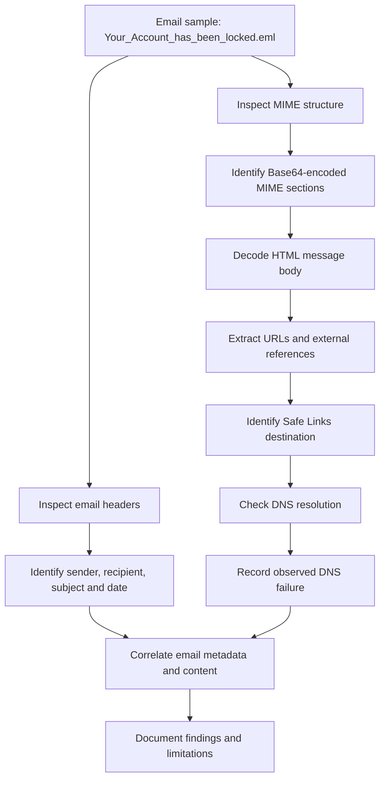

# Malware Analysis - Phishing Analysis 2

## Challenge Information

| Field | Details |
|---|---|
| Platform | Blue Team Labs Online (BTLO) |
| Category | Malware Analysis |
| Challenge | Phishing Analysis 2 |
| Environment | Linux |
| Preparation Context | Blue Team Level 1 (BTL1) |
| Evidence Screenshot | `Screenshot_8.png` |

## Overview

This challenge focuses on examining a suspicious email that claims the recipient's Amazon account has been locked. The analysis uses email headers and MIME structure to identify the sender, recipient, subject, and message date, then decodes the Base64-encoded HTML body to extract URLs and other observable indicators.

The investigation also examines the URL protection wrapper, identifies the embedded destination, and records the result of a DNS reachability check performed during the original analysis.

The objective is to demonstrate a practical email-phishing investigation workflow using command-line tools available in Linux.

## Investigation Objectives

- Inspect the email headers and identify relevant message metadata.
- Determine which company the email attempts to impersonate.
- Identify MIME sections encoded using Base64.
- Decode the HTML message body for further inspection.
- Extract URLs and distinguish the Safe Links wrapper from its embedded destination.
- Record relevant domains and external references as observables.
- Document the result and limitations of the website reachability check.

## Tools and Utilities

| Tool | Purpose |
|---|---|
| `grep` | Search email headers and identify MIME markers. |
| `sed` | Extract selected lines from the email file. |
| `base64` | Decode Base64-encoded message content. |
| `tr` | Remove carriage-return and newline characters before decoding. |
| `curl` | Perform an HTTP HEAD request to check the target host's reachability. |
| `sort` | Organize and deduplicate extracted URLs. |
| CyberChef | Alternative method for decoding Base64 content. |
| Webshot.site / ShowMySites | Alternative services referenced for website screenshots. |

## Evidence and Working Files

| Item | Description |
|---|---|
| `Your_Account_has_been_locked.eml` | Original email sample examined in the challenge. |
| `body.html` | HTML content decoded from the Base64 MIME section. |
| `Screenshot_8.png` | Screenshot documenting the challenge. |

The email sample was examined in the original Linux working environment. The screenshot included in this repository is retained as supporting challenge evidence.
## Investigation Workflow

### 1. Prepare the Working Environment

The original email sample was located in the Linux Downloads directory.

```bash
cd ~/Downloads
ls -la
```

Confirm that `Your_Account_has_been_locked.eml` is present before starting the investigation.

### 2. Inspect the Email Headers

Search the message for the sender, recipient, and subject fields:

```bash
grep -i "^From:" Your_Account_has_been_locked.eml
grep -i "^To:" Your_Account_has_been_locked.eml
grep -i "^Subject:" Your_Account_has_been_locked.eml
```

The extracted values were:

| Header | Observed Value |
|---|---|
| From | `amazon@zyevantoby.cn` |
| To | `saintington73@outlook.com` |
| Subject | `Your Account has been locked` |

The sender address uses the `zyevantoby.cn` domain rather than an Amazon-owned domain. The message uses Amazon branding and an account-lock notification theme, indicating an attempt to impersonate Amazon.

The message date was recorded as:

```text
Wed, 14 Jul 2021 01:40:32 +0900
```

This timestamp corresponds to `2021-07-13 16:40:32 UTC`.
### 3. Identify MIME Boundaries and Base64 Sections

Search for Base64 transfer-encoding declarations and MIME boundary markers:

```bash
grep -n "Content-Transfer-Encoding: base64" Your_Account_has_been_locked.eml
grep -n "NextPart" Your_Account_has_been_locked.eml
```

In the examined sample, the relevant encoded sections were identified at:

| Content | Sample Line Range |
|---|---|
| Plain-text Base64 section | 131-147 |
| HTML Base64 section | 152-154 |

The MIME boundary markers separate the message parts. These line ranges are specific to this email sample and may change if the message is reformatted.

### 4. Decode the HTML Message Body

Extract and decode the HTML Base64 section:

```bash
sed -n '152,154p' Your_Account_has_been_locked.eml | tr -d '\r' | base64 -d > body.html
```

Verify that the output file was created and inspect its beginning:

```bash
ls -la body.html
head -c 200 body.html
```

The decoded content begins with an HTML document declaration:

```html
<!DOCTYPE HTML>
```

This confirms that the extracted section contains HTML-formatted message content.
### 5. Extract URLs from the Decoded HTML

Search the decoded HTML file for HTTPS URLs and remove duplicate entries:

```bash
grep -o 'https://[^"]*' body.html | sort -u
```

The extracted URLs included the following references:

| URL | Context |
|---|---|
| `https://amaozn.zzyuchengzhika.cn/?mailtoken=saintington73@outlook.com` | Account-verification destination referenced by the message. |
| `https://emea01.safelinks.protection.outlook.com/?url=...` | Microsoft Safe Links wrapper containing an encoded destination URL. |
| `https://images.squarespace-cdn.com/content/52e2b6d3e4b06446e8bf13ed/1500584238342-OX2L298XVSKF8AO6I3SV/amazon-logo?format=750w&content-type=image%2Fpng` | Amazon-branded logo image hosted on Squarespace CDN. |
| `https://www.facebook.com/amir.boyka.7` | Facebook profile reference present in the message. |

The extracted destination hostname is `amaozn.zzyuchengzhika.cn`. Its spelling differs from the legitimate Amazon brand name and should be preserved exactly as observed.

### 6. Examine the Safe Links Wrapper

The email contains a Microsoft Safe Links URL that wraps an encoded destination. The original challenge notes contain an abbreviated wrapper:

```text
https://emea01.safelinks.protection.outlook.com/?url=https%3A%2F%2Famaozn.zzyuchengzhika.cn%2F%3Fmailtoken%3Dsaintington73%40outlook.com&data=...
```

The embedded destination was identified separately:

```text
https://amaozn.zzyuchengzhika.cn/?mailtoken=saintington73@outlook.com
```

The Safe Links address is a protection wrapper; the embedded URL is the destination referenced by the message. The abbreviated wrapper is retained as recorded in the original notes. Missing query parameters have not been reconstructed or invented.
### 7. Check the Destination Host's DNS Reachability

The original analysis included an HTTP HEAD request to check whether the destination hostname could be resolved:

```bash
curl -I https://amaozn.zzyuchengzhika.cn
```

The recorded result was:

```text
curl: (6) Could not resolve host
```

The challenge website snapshot displayed the following message:

```text
This web page could not be loaded.
```

The DNS resolution failure indicates that the hostname could not be resolved from the analysis environment at the time of testing.

This result does not establish that the domain never existed, that it was permanently unavailable, or that its infrastructure was malicious. It records only the result observed during the original analysis.

### 8. Identify the Message Encoding

The email contains MIME sections marked with:

```text
Content-Transfer-Encoding: base64
```

The encoding used for these message sections is Base64.

The presence of this header identifies the transfer encoding of the corresponding MIME part. It does not mean that the entire email message is Base64-encoded.

### 9. Record the Logo Image Reference

The decoded HTML contains an image URL pointing to an Amazon-branded logo hosted on Squarespace CDN:

```text
https://images.squarespace-cdn.com/content/52e2b6d3e4b06446e8bf13ed/1500584238342-OX2L298XVSKF8AO6I3SV/amazon-logo?format=750w&content-type=image%2Fpng
```

The URL is recorded as an observable because it appears in the message HTML.

The hosting domain alone does not establish that the image or hosting service is malicious.

### 10. Record the Facebook Profile Reference

The decoded message also contains the following Facebook profile URL:

```text
https://www.facebook.com/amir.boyka.7
```

The observed profile reference is:

```text
amir.boyka.7
```

This value is documented as an observable extracted from the email. No attribution or identity claim is made based solely on this reference.
## Challenge Questions and Answers

| Question | Answer | Evidence / Explanation |
|---|---|---|
| Q1. Who sent the email? | `amazon@zyevantoby.cn` | Extracted from the `From` header. |
| Q2. Who received the email? | `saintington73@outlook.com` | Extracted from the `To` header. |
| Q3. What is the email subject? | `Your Account has been locked` | Extracted from the `Subject` header. |
| Q4. Which company is being impersonated? | Amazon | The message uses Amazon branding and an account-lock notification theme. |
| Q5. When was the email sent? | `Wed, 14 Jul 2021 01:40:32 +0900` | Equivalent to `2021-07-13 16:40:32 UTC`. |
| Q6. What is the destination behind the Safe Links URL? | `https://amaozn.zzyuchengzhika.cn/?mailtoken=saintington73@outlook.com` | Extracted from the encoded destination in the Safe Links wrapper. |
| Q7. What happened when the destination website was checked? | `This web page could not be loaded.` | The original `curl` check returned `Could not resolve host`. |
| Q8. What encoding is used in the email body sections? | Base64 | Identified by the `Content-Transfer-Encoding: base64` MIME header. |
| Q9. Where is the Amazon logo image hosted? | Squarespace CDN (`images.squarespace-cdn.com`) | Identified from the image URL in the decoded HTML. |
| Q10. What Facebook username is referenced in the email? | `amir.boyka.7` | Extracted from the Facebook profile URL. |

The answers above are based on the email sample and the observations recorded during the challenge. The destination URL, DNS result, and external references are documented as observed, without making unsupported claims about ownership, attribution, or current availability.
## Indicators of Compromise (IOCs) and Observables

The investigation identified the following indicators and observable references in the email sample.

| Type | Observable | Assessment |
|---|---|---|
| Sender email | `amazon@zyevantoby.cn` | Suspicious sender address using a non-Amazon domain. |
| Sender domain | `zyevantoby.cn` | Does not match Amazon's legitimate domain. |
| Recipient email | `saintington73@outlook.com` | Recipient identified in the email header. |
| Subject | `Your Account has been locked` | Account-lock notification used as the phishing lure. |
| Impersonated brand | Amazon | Amazon branding is used to make the message appear legitimate. |
| Destination domain | `amaozn.zzyuchengzhika.cn` | Suspicious lookalike-style hostname containing the misspelled string `amaozn`. |
| Destination URL | `https://amaozn.zzyuchengzhika.cn/?mailtoken=saintington73@outlook.com` | Destination extracted from the Safe Links URL. |
| Image host | `images.squarespace-cdn.com` | External image hosting reference; not considered malicious based on this evidence alone. |
| Facebook reference | `amir.boyka.7` | Profile reference extracted from the email; no identity attribution made. |

The indicators above are extracted from the provided email sample. Their presence alone does not establish that every referenced domain or service is malicious.

## Investigation Flow

The following diagram summarizes the main analytical steps performed during the challenge.



## Key Findings

- The email claims that the recipient's Amazon account has been locked.
- The sender address uses the domain `zyevantoby.cn`, rather than an Amazon-owned domain.
- The message uses Amazon branding to support the account-lock notification theme.
- The decoded HTML contains a destination hosted under `zzyuchengzhika.cn`.
- The destination hostname contains the misspelled string `amaozn`, which is consistent with a lookalike-style naming technique.
- The destination URL includes the recipient's email address as a `mailtoken` parameter.
- The original DNS check failed with the message `Could not resolve host`.
- The email contains Base64-encoded MIME body sections, which were decoded to inspect the HTML content.
- The extracted Squarespace image URL and Facebook profile reference were recorded as observables, without assuming that these services are malicious or that the profile identifies the sender.

## Investigation Limitations

- The destination domain could not be resolved during the recorded DNS check. This does not prove that the domain never existed or that it is permanently unavailable.
- The destination website content could not be retrieved during the original check.
- No live interaction with the suspicious destination URL was performed.
- The available evidence does not establish whether the recipient opened the email, clicked the link, submitted credentials, or experienced account compromise.
- The extracted Facebook username is documented only as an observable. No attribution or identity claim is made.
- The investigation is limited to the supplied email sample and the command output recorded during the challenge.

## Conclusion

The email exhibits multiple characteristics consistent with a phishing attempt, including Amazon brand impersonation, a suspicious sender domain, an account-lock lure, and a destination URL hosted on a different domain with a lookalike-style hostname.

The MIME structure was examined, Base64-encoded message sections were decoded, and URLs and external references were extracted from the HTML body. The destination domain could not be resolved during the recorded check.

Based on the available evidence, the message should be treated as suspicious and handled as a potential phishing email. The investigation does not establish successful user interaction, credential theft, or account compromise.

## Evidence Integrity

The challenge screenshot was copied into the challenge directory and its SHA256 hash was verified against the original source file.

| Evidence File | SHA256 |
|---|---|
| `Screenshot_8.png` | `562DA64F17142C17771F369051BC1C255A516A5F6932B7591C5015EC585E79E5` |

The matching source and copied-file hashes confirm that the screenshot was not altered during the copy operation.

## Skills Demonstrated

- Email header analysis
- Phishing email identification
- MIME structure inspection
- Base64 decoding
- HTML content inspection
- URL extraction and analysis
- Safe Links destination identification
- DNS resolution checks
- IOC and observable documentation
- Evidence integrity verification using SHA256
- Analytical reporting with evidence-based conclusions
