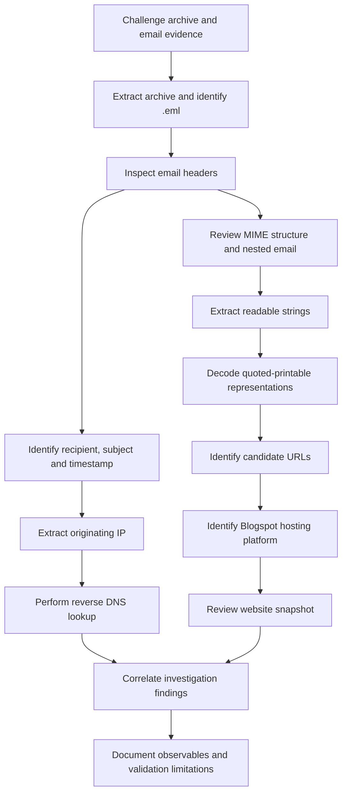

# Malware Analysis - Phishing Analysis

## Challenge Information

| Field | Details |
|---|---|
| Platform | Blue Team Labs Online (BTLO) |
| Challenge | Malware Analysis - Phishing Analysis |
| Category | Malware Analysis / Email Analysis |
| Environment | Kali Linux |
| Training Context | BTL1 (Blue Team Level 1) exam preparation |

## Overview

This challenge focuses on investigating a suspicious email message and identifying relevant email headers, originating infrastructure, embedded URLs, and hosting information.

The investigation follows a practical email-analysis workflow:
- Inspecting email headers and message metadata.
- Identifying recipient, subject, and message timestamp.
- Extracting the originating IP address.
- Performing reverse DNS lookups.
- Reviewing MIME structure and nested email content.
- Extracting and reconstructing URLs from the message.
- Identifying the hosting platform associated with the URLs.
- Reviewing an external website snapshot and documenting the result.

The objective is to extract and correlate relevant indicators while distinguishing confirmed evidence from information that requires additional validation.

## Tools and Environment

The investigation was performed using Kali Linux and the following tools and services:

| Tool | Purpose |
|---|---|
| `unzip` | Extracting the challenge archive |
| `grep` | Searching email headers and message content |
| `date` | Converting the message timestamp to UTC |
| `strings` | Extracting readable strings from the email |
| `sed` | Decoding quoted-printable representations |
| `fold` | Wrapping long output lines for inspection |
| `dig` | Performing reverse DNS lookups |
| `host` | Performing DNS lookups |
| DomainTools | Additional domain and DNS investigation |
| Webshot.site | Reviewing a screenshot of the referenced website |

## Preparation

The challenge archive and email evidence were prepared in the Downloads directory.

```bash
cd ~/Downloads
ls -la
unzip be3c0ced06b383dc321e49d1122cf0e53f8cf5db.zip
```

The archive password supplied by the challenge was:

```text
btlo
```

The email evidence examined during the investigation was:

```text
Website contact form submission.eml
```

## Investigation Workflow

### 1. Email Header Analysis

The first step was to inspect the email headers and identify the recipient, subject, date, and originating IP address.

**Recipient**

```bash
grep -i "^To:" "Website contact form submission.eml"
```

Recorded output included:

```text
To: john smith <johnsmith123@gmail.com>
To: kinnar1975@yahoo.co.uk
```

Challenge answer:

```text
johnsmith123@gmail.com
```

**Subject**

```bash
grep -i "^Subject:" "Website contact form submission.eml"
```

Recorded output included:

```text
Subject: Website contact form submission
Subject: Undeliverable: Website contact form submission
Subject: Website contact form submission
```

Challenge answer:

```text
Undeliverable: Website contact form submission
```

**Important observation:** Multiple recipient and subject headers were present in the extracted output. This may be related to nested or forwarded email content. Header values should be interpreted in the context of their MIME boundaries rather than automatically treated as headers belonging to one message.

### 2. Timestamp Analysis

The message date was identified from the email headers:

```bash
grep -i "^Date:" "Website contact form submission.eml"
```

Recorded timestamp:

```text
Thu, 18 Mar 2021 15:13:56 +1100
```

The timestamp was converted to UTC:

```bash
date -d "Thu, 18 Mar 2021 15:13:56 +1100" -u
```

Converted timestamp:

```text
Thu Mar 18 04:13:56 AM UTC 2021
```

Challenge answer:

```text
18 March 2021 04:13 UTC
```

### 3. Originating IP Address

The originating IP address was extracted from the `X-Originating-IP` header:

```bash
grep -i "x-originating-ip" "Website contact form submission.eml"
```

Recorded value:

```text
103.9.171.10
```

This address was used for subsequent reverse DNS investigation.

### 4. Reverse DNS Investigation

A reverse DNS lookup was performed against the originating IP address:

```bash
dig -x 103.9.171.10 +short
```

Recorded result:

```text
c5s2-1e-syd.hosting-services.net.au
```

The hostname provides additional infrastructure context associated with the originating IP address. A reverse DNS result alone does not establish ownership, malicious intent, or the identity of the sender.

### 5. MIME and Attachment Analysis

The email content was reviewed for MIME attachment information:

```bash
grep -i "content-type\|content-disposition" "Website contact form submission.eml"
```

The original investigation notes identify a nested email message with the filename:

```text
Website contact form submission.eml
```

The presence of an email file inside another email is relevant because nested messages can contain additional headers, content, and links that may not be immediately visible when examining only the outer message.

The MIME boundaries and `Content-Disposition` fields should be examined together when validating the exact attachment relationship.

### 6. URL Extraction and Decoding

Readable strings were extracted from the email:

```bash
strings -n 8 "Website contact form submission.eml" > strings_output.txt
```

Quoted-printable representations were then normalized:

```bash
sed 's/=3D/=/g' strings_output.txt > decoded_urls.txt
```

The output was wrapped and searched for HTTP or HTTPS references:

```bash
cat decoded_urls.txt | fold -w200 | grep -A 2 "https"
```

The original investigation notes recorded the following concatenated output:

```text
https://35000usdperwwekpodf.blogspot.sg?p=9swghttps://35000usdperwwekpodf.blogspot.co.il?o=0hnd
```

This output appears to contain two candidate URL strings:

```text
https://35000usdperwwekpodf.blogspot.sg?p=9swg
https://35000usdperwwekpodf.blogspot.co.il?o=0hnd
```

**Validation note:** The two URLs are reconstructed from a concatenated output. Their separation is an interpretation of the recorded string and should be confirmed against the original MIME content before treating them as independently verified complete URLs.

The URLs were documented without opening them directly.

### 7. Hosting Platform Identification

The candidate hostnames use the following domains:

```text
blogspot.sg
blogspot.co.il
```

These domains are associated with the Blogspot/Blogger publishing platform.

Challenge answer:

```text
blogspot
```

The hosting platform identifies the service associated with the domain. It does not, by itself, establish that the specific page or account was malicious.

### 8. Website Snapshot Review

The referenced website was reviewed using Webshot.site as an alternative to URL2PNG.

The recorded snapshot result was:

```text
Blog has been removed
```

This indicates that the page was reported as removed when the snapshot was obtained.

It does not establish whether the page was available at the time the original email was sent, nor does it reveal the original page content.

## Consolidated Answers

| Question | Finding |
|---|---|
| Q1 - Primary recipient | johnsmith123@gmail.com |
| Q2 - Subject | Undeliverable: Website contact form submission |
| Q3 - Sent date/time | 18 March 2021 04:13 UTC |
| Q4 - Originating IP | 103.9.171.10 |
| Q5 - Reverse DNS | c5s2-1e-syd.hosting-services.net.au |
| Q6 - Email attachment | Website contact form submission.eml |
| Q7 - Embedded URL references | Two candidate Blogspot URLs reconstructed from concatenated output |
| Q8 - Hosting platform | blogspot |
| Q9 - Website snapshot result | Blog has been removed |

## IOC and Observable Summary

| Type | Value | Context |
|---|---|---|
| IPv4 address | `103.9.171.10` | Value recorded in the `X-Originating-IP` header |
| Reverse DNS | `c5s2-1e-syd.hosting-services.net.au` | Reverse DNS result for the originating IP |
| Domain | `35000usdperwwekpodf.blogspot.sg` | Candidate hostname reconstructed from extracted output |
| Domain | `35000usdperwwekpodf.blogspot.co.il` | Candidate hostname reconstructed from extracted output |
| URL | `https://35000usdperwwekpodf.blogspot.sg?p=9swg` | Candidate URL reconstructed from concatenated output |
| URL | `https://35000usdperwwekpodf.blogspot.co.il?o=0hnd` | Candidate URL reconstructed from concatenated output |
| Email filename | `Website contact form submission.eml` | Nested email filename recorded in the investigation notes |
| Email subject | `Undeliverable: Website contact form submission` | Subject associated with the challenge answer |

**IOC handling note:** These values are challenge-derived observables. Their presence in the evidence does not independently prove that every associated system, domain, or URL was malicious. The reconstructed URLs require validation against the original MIME content.

## Investigation Flow



## DFIR Findings and Relevance

The investigation identified several useful email-analysis artifacts:

1. **Email metadata:** Recipient, subject, and timestamp provide initial context for reconstructing the message.
2. **Originating infrastructure:** The `X-Originating-IP` value and its reverse DNS result provide infrastructure indicators for further investigation.
3. **Nested email content:** The recorded `.eml` filename highlights the importance of examining MIME structure and nested messages.
4. **Embedded URL references:** String extraction and quoted-printable normalization exposed candidate Blogspot URLs.
5. **Website availability:** The snapshot service returned `Blog has been removed`, documenting the page state at the time of that lookup.

The findings should be correlated with the original message structure and other available evidence before making definitive attribution or maliciousness assessments.

## Key Learning Points

- Email headers are valuable sources of metadata during phishing investigations.
- Multiple header occurrences can indicate nested or forwarded email content.
- Time zones must be normalized before correlating email timestamps with other logs.
- The `X-Originating-IP` header can provide an infrastructure lead, but its trustworthiness must be assessed.
- MIME structure should be examined to identify nested messages and attachments.
- Quoted-printable encoding can obscure URL characters and parameters.
- Extracted URL strings should be validated against the original message before being treated as confirmed indicators.
- Website snapshot results describe the observed state at lookup time, not necessarily the state when the email was delivered.

## Limitations

- The recorded URL output was concatenated. The proposed separation into two URLs requires confirmation against the original MIME content.
- Multiple `To:` and `Subject:` values were recorded. Their exact relationship to the outer and nested messages requires MIME-context validation.
- The reverse DNS result does not establish the identity of the sender or prove malicious activity.
- The website snapshot result does not establish the historical content or availability of the page.
- No conclusion about malware execution or successful compromise can be drawn from the documented email artifacts alone.
- The original investigation notes and challenge screenshot are retained as supporting evidence.

## Conclusion

This challenge demonstrates a practical workflow for examining suspicious email evidence, extracting relevant metadata, investigating originating infrastructure, and identifying embedded URL references.

The investigation produced a set of useful observables, including an originating IP address, a reverse DNS hostname, candidate Blogspot URLs, and a nested email filename.

The results are documented with explicit validation caveats. In particular, the reconstructed URLs and multiple email-header values require examination in their original MIME context before they can be treated as definitive findings.

## Evidence

| Evidence | Description |
|---|---|
| `Screenshot_12.png` | Original BTLO challenge screenshot |
| `Screenshot_12.png` SHA256 | `F54F180EEFE5621FA6464B9182C97B5C929CD123E3023B5693CE7DD14D88DA5E` |

The screenshot was copied from the original BTLO evidence directory into this challenge folder. The source and copied files were verified to have matching SHA256 hashes.

