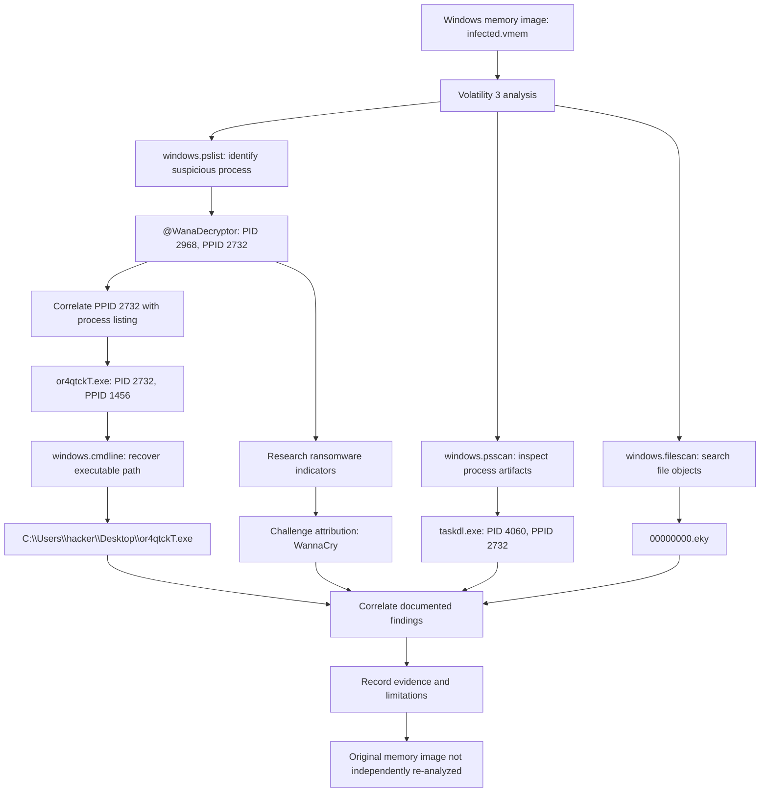

# Memory Analysis - Ransomware

## Challenge Information

| Field | Details |
|---|---|
| Platform | Blue Team Labs Online (BTLO) |
| Category | Memory Forensics / Malware Analysis |
| Environment | Linux |
| Tool | Volatility 3 |
| Evidence File | infected.vmem |
| Completion Date | 24 September 2026, 09:31 |
| Training Context | BTL1 (Blue Team Level 1) preparation |

## 1. Challenge Overview

This challenge focuses on investigating a Windows memory image to identify suspicious processes, reconstruct process relationships, locate the original executable, and identify the ransomware family.

The investigation uses Volatility 3 to examine process information, command-line arguments, and file objects recovered from memory.

The documented analysis identifies indicators associated with a WannaCry ransomware infection.

## 2. Tools and Techniques

| Tool / Plugin | Purpose |
|---|---|
| Volatility 3 | Memory forensic framework |
| windows.pslist | Lists processes using process-list information |
| windows.psscan | Scans memory for process objects |
| windows.cmdline | Retrieves process command-line information |
| windows.filescan | Scans memory for file objects |
| windows.pstree | Displays parent-child process relationships |
| grep | Filters command output |
| Google | Researches malware indicators and ransomware attribution |

## 3. Investigation Workflow

### Step 1 - Environment Preparation

Volatility 3 was installed in the Linux environment.

    pip install volatility3 --break-system-packages

Installation verification:

    vol --help

Navigate to the challenge directory:

    cd ~/Downloads/BTLO\ Memory\ Analysis\ -\ Ransomware

Review the available files:

    ls -la

The `--break-system-packages` option was used in the documented Linux environment to work around the externally-managed Python environment restriction.

### Step 2 - Identify the Suspicious Process

Command:

    vol -f infected.vmem windows.pslist

The process listing contained a suspicious entry:

| PID | PPID | Process |
|---:|---:|---|
| 2968 | 2732 | @WanaDecryptor |

The unusual process name and its relationship with another suspicious process made it relevant for further investigation.

**Finding:** `@WanaDecryptor`

### Step 3 - Identify the Parent Process ID

Command:

    vol -f infected.vmem windows.pslist | grep -i "WanaDecryptor"

The output showed the suspicious process with PPID `2732`.

**Finding:** `2732`

### Step 4 - Identify the Initial Malicious Executable

Command:

    vol -f infected.vmem windows.pslist | grep -i "2732"

The documented output contained:

    2732    1456    or4qtckT.exe

PID `2732` matched the parent process ID identified in the previous step.

**Finding:** `or4qtckT.exe`

This establishes the process relationship recorded in the challenge notes.

### Step 5 - Identify the Process Associated with File Deletion

Command:

    vol -f infected.vmem windows.psscan | grep 2732

The documented output contained:

    4060    2732    taskdl.exe

The process `taskdl.exe` was associated with the same parent PID.

Its name and relationship to the suspicious process were used to identify it as the process associated with file deletion in this challenge.

**Finding:** `taskdl.exe`

### Step 6 - Determine the Initial Execution Path

Command:

    vol -f infected.vmem windows.cmdline | grep -i "or4qtckT"

The documented command-line output showed:

    2732    or4qtckT.exe    "C:\Users\hacker\Desktop\or4qtckT.exe"

**Finding:** `C:\Users\hacker\Desktop\or4qtckT.exe`

This identifies the executable path recorded in the process command-line information.

### Step 7 - Identify the Ransomware Family

The process name `@WanaDecryptor` was researched as a malware indicator.

The challenge investigation associated this process and the initial executable with WannaCry ransomware.

**Finding:** `WannaCry`

This attribution is based on the challenge investigation and indicator research documented in the source notes.

### Step 8 - Locate the .eky File

Command:

    vol -f infected.vmem windows.filescan | grep -i "\.eky"

The documented output contained:

    0x1fca6268    100.0\Users\hacker\Desktop\00000000.eky

The file object identified by the scan was:

**Finding:** `00000000.eky`

The file was associated with the ransomware key material described in the challenge question.

## 4. Answers

| Question | Answer |
|---|---|
| Q1 - Name of the suspicious process | `@WanaDecryptor` |
| Q2 - Parent process ID | `2732` |
| Q3 - Initial malicious executable | `or4qtckT.exe` |
| Q4 - Process used to delete files | `taskdl.exe` |
| Q5 - Initial execution path | `C:\Users\hacker\Desktop\or4qtckT.exe` |
| Q6 - Ransomware family | `WannaCry` |
| Q7 - Filename with the `.eky` extension | `00000000.eky` |

## 5. Volatility Plugin Reference

| Plugin | Purpose | Forensic Use |
|---|---|---|
| `windows.pslist` | Lists processes | Initial process review |
| `windows.psscan` | Scans memory for process objects | Identifying additional process artifacts |
| `windows.cmdline` | Retrieves command-line arguments | Investigating execution paths and arguments |
| `windows.filescan` | Scans for file objects | Locating file artifacts in memory |
| `windows.pstree` | Displays process relationships | Understanding parent-child process activity |

### Important Interpretation Notes

- `windows.pslist` and `windows.psscan` use different approaches to identify process artifacts.
- A process found by `psscan` is not automatically malicious or hidden; its state and context must be examined.
- PID and PPID relationships help reconstruct process execution chains.
- Command-line artifacts can reveal executable paths and arguments.
- A file object found by `filescan` does not, by itself, prove that the file was successfully executed or recovered.

## 6. Key DFIR Findings

The documented process relationship is:

    or4qtckT.exe (PID 2732)
        |
        +-- @WanaDecryptor (PID 2968)
        |
        +-- taskdl.exe (PID 4060)

The investigation recorded the following artifacts:

| Artifact | Recorded Value | Significance |
|---|---|---|
| Suspicious process | `@WanaDecryptor` | Indicator associated with WannaCry |
| Parent process | `or4qtckT.exe` | Initial executable identified in the process listing |
| Parent PID | `2732` | Connects the identified process artifacts |
| Related process | `taskdl.exe` | Associated with file deletion in the challenge |
| Execution path | `C:\Users\hacker\Desktop\or4qtckT.exe` | Recorded executable location |
| Key-related file | `00000000.eky` | Ransomware-related file artifact |
| Ransomware family | WannaCry | Challenge attribution |

## 7. Investigation Limitations

The documentation is based on the original challenge notes and the command outputs transcribed in those notes.

The following limitations apply:

- The original memory image `infected.vmem` was not independently re-analyzed while preparing this repository entry.
- The listed command outputs are reproduced from the challenge notes and are not presented as newly acquired forensic evidence.
- The role of `taskdl.exe` is recorded according to the original challenge investigation; its behavior was not independently validated through additional memory artifacts.
- The WannaCry attribution reflects the challenge investigation and indicator research.
- The presence of `00000000.eky` in a memory scan does not independently establish the complete cryptographic role or successful recovery of the file.
- No claim is made that a real endpoint was compromised based solely on this training exercise.

## 8. BTL1 Learning Outcomes

This challenge reinforces practical memory-forensics skills relevant to incident response:

1. Enumerating processes in a Windows memory image.
2. Identifying suspicious process names and execution relationships.
3. Using PID and PPID values to reconstruct process activity.
4. Examining process command-line information.
5. Searching memory for file-object artifacts.
6. Correlating multiple artifacts when investigating ransomware.
7. Distinguishing observed artifacts from conclusions that require further validation.

## 9. Evidence

- `screenshot.png` - BTLO challenge completion screenshot.
- `README.md` - Challenge methodology, commands, answers, findings, and limitations.

---

**Training Disclaimer:** This repository documents a controlled Blue Team Labs Online exercise performed as part of BTL1 preparation. It is intended for educational and defensive security purposes.

## Memory Forensics Process Correlation

