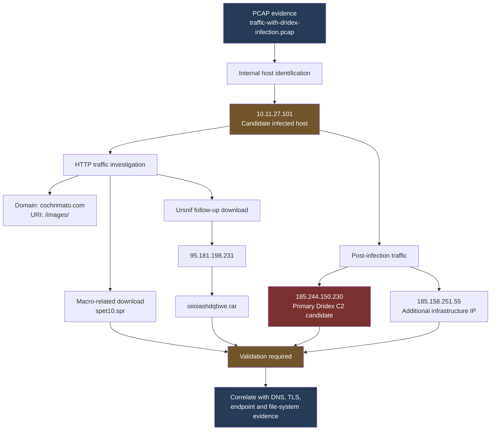
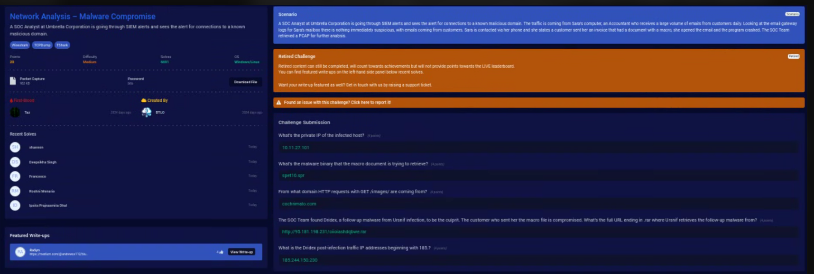

# Network Analysis - Malware Compromise

## Challenge Information

| Field | Details |
|---|---|
| Challenge | Network Analysis - Malware Compromise |
| Platform | Blue Team Labs Online (BTLO) |
| Category | Network Analysis / Malware Analysis |
| Environment | Linux |
| Evidence | PCAP network capture |
| Main Tool | TShark |
| Malware Families | Dridex / Ursnif |
| Status | Completed |

## Overview

This challenge focuses on investigating a network capture associated with malware activity.

The investigation uses TShark to examine packet-level data, identify the infected internal host, inspect HTTP requests, identify downloaded malware-related files, and extract suspicious external IP addresses.

The documented findings are based on the original challenge investigation notes. The original PCAP has not been independently re-acquired or re-analysed during preparation of this repository.

## Evidence

Primary evidence file:

- `traffic-with-dridex-infection.pcap`

Screenshot evidence:

- `images/Screenshot_31.png`

The screenshot was copied from the original source directory. Its SHA256 hash was verified against the source image.

## Investigation Methodology

### 1. Identify the PCAP file

    cd ~/Downloads/Network\ Analysis
    file traffic-with-dridex-infection.pcap

The `file` command identifies the file type and provides an initial validation of the evidence format.

### 2. Review protocol statistics

    tshark -r traffic-with-dridex-infection.pcap -q -z io,phs

This command displays protocol hierarchy statistics and helps identify the protocols present in the capture.

### 3. Identify frequently occurring source IP addresses

    tshark -r traffic-with-dridex-infection.pcap -T fields -e ip.src | sort | uniq -c | sort -rn | head -10

This command extracts source IP addresses, counts their occurrences, and displays the most frequent values.

A high packet count can help identify a candidate infected host, but frequency alone does not prove infection.

### 4. Inspect HTTP requests

    tshark -r traffic-with-dridex-infection.pcap -Y "http.request" -T fields -e http.host -e http.request.uri -e http.user_agent

The HTTP display filter extracts request metadata, including:

- Requested host
- Request URI
- User-Agent

These fields can reveal suspicious downloads and potentially malicious infrastructure.

### 5. Identify requests to the /images/ path

    tshark -r traffic-with-dridex-infection.pcap -Y "http.request.uri contains \"/images/\"" -T fields -e http.host

This filter identifies HTTP requests whose URI contains `/images/` and displays the corresponding hostnames.

### 6. Search for RAR archive downloads

    tshark -r traffic-with-dridex-infection.pcap -Y "http.request" -T fields -e http.host -e http.request.uri | grep -i "\.rar"

The output can reveal HTTP requests targeting RAR archive resources.

The hostname and URI should be combined to reconstruct the full URL.

### 7. Identify candidate Dridex post-infection destinations

    tshark -r traffic-with-dridex-infection.pcap -Y "ip.addr==10.11.27.101 && !(http || tls.handshake.type==1)" -T fields -e ip.dst | sort -u | grep "^185."

This command filters traffic involving the identified internal host, excludes HTTP and TLS Client Hello packets, and extracts unique destination IP addresses beginning with `185.`.

The resulting destinations require contextual analysis before being classified as command-and-control infrastructure.

## Questions and Answers

| # | Question | Answer |
|---|---|---|
| 1 | What is the private IP of the infected host? | `10.11.27.101` |
| 2 | What malware binary is the macro document trying to retrieve? | `spet10.spr` |
| 3 | From what domain do HTTP requests with GET /images/ originate? | `cochrimato.com` |
| 4 | What is the full URL ending in .rar used by Ursnif to retrieve follow-up malware? | `http://95.181.198.231/oiioiashdqbwe.rar` |
| 5 | What is the primary Dridex post-infection traffic IP beginning with 185.? | `185.244.150.230` |

## Key Indicators

| Indicator | Value | Context |
|---|---|---|
| Infected internal host | `10.11.27.101` | Candidate compromised endpoint |
| Downloaded binary | `spet10.spr` | Malware-related download |
| HTTP domain | `cochrimato.com` | Requests to `/images/` |
| Archive URL | `http://95.181.198.231/oiioiashdqbwe.rar` | Ursnif follow-up download |
| Primary Dridex C2 candidate | `185.244.150.230` | Expected BTLO answer |
| Additional infrastructure IP | `185.158.251.55` | Also identified in source notes |

## PCAP Traffic Analysis Reference

| Traffic Type | TShark Filter / Field | Investigation Purpose |
|---|---|---|
| HTTP requests | `-Y "http.request"` | Inspect host, URI and User-Agent |
| HTTP responses | `-Y "http.response"` | Inspect response metadata |
| DNS queries | `-Y "dns.qr==0"` | Identify requested domain names |
| TLS Client Hello | `-Y "tls.handshake.type==1"` | Inspect TLS connection initiation |
| IP addresses | `-T fields -e ip.src -e ip.dst` | Identify communication endpoints |

Useful field references:

- `http.host` - HTTP Host header.
- `http.request.uri` - Requested resource path.
- `http.user_agent` - Client identification string.
- `dns.qry.name` - DNS query name.
- `ip.src` - Source IP address.
- `ip.dst` - Destination IP address.

## DFIR Findings

The challenge investigation identifies `10.11.27.101` as the candidate infected internal host.

HTTP request metadata reveals a malware-related download named `spet10.spr` and requests to `cochrimato.com` involving the `/images/` URI path.

An additional HTTP request identifies an archive URL associated with the Ursnif follow-up malware retrieval.

Post-infection traffic analysis identifies two external IP addresses in the `185.x.x.x` range. The challenge expects `185.244.150.230` as the primary Dridex C2 answer, while `185.158.251.55` is also mentioned in the source notes.

These indicators should be correlated with DNS, TLS, endpoint telemetry, process execution and file-system evidence during a complete incident investigation.

### Malware Network Investigation Flow

**Evidence note:** The diagram summarizes indicators documented in the original challenge notes. The original PCAP was not independently re-acquired or re-analyzed during repository documentation. File requests do not independently confirm successful downloads or execution, and the external IP addresses require contextual validation before definitive malware infrastructure attribution.

## Limitations and Evidence Notes

- The original PCAP was not independently re-acquired or re-analysed while preparing this repository.
- Answers and indicators are documented from the original challenge notes.
- High source-IP frequency alone does not establish that a host is infected.
- An HTTP request for a file does not independently prove successful download or execution.
- A suspicious domain or IP address requires contextual validation before being classified as malicious infrastructure.
- TLS Client Hello filtering does not reveal encrypted application content.
- The identification of `185.244.150.230` as the primary Dridex C2 reflects the expected BTLO answer and the source investigation notes, not independent attribution.
- The presence of an IP address in a packet capture does not establish the identity of the operator behind it.

## Learning Outcomes

- Using TShark for command-line PCAP analysis.
- Reviewing protocol hierarchy statistics.
- Extracting and counting IP addresses.
- Filtering HTTP requests and inspecting request metadata.
- Identifying suspicious file downloads and archive URLs.
- Investigating potential command-and-control communication.
- Understanding the limitations of network-only evidence.
- Correlating network indicators with endpoint telemetry.

## Conclusion

This challenge demonstrates a practical workflow for investigating suspected malware activity through packet capture analysis.

TShark provides an effective command-line approach for extracting network indicators and identifying suspicious communication patterns.

The findings provide investigation leads that should be correlated with endpoint and other security telemetry before making definitive incident conclusions.

## Screenshot

