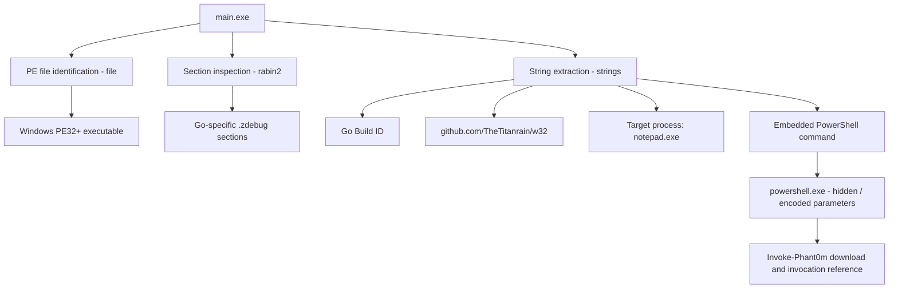
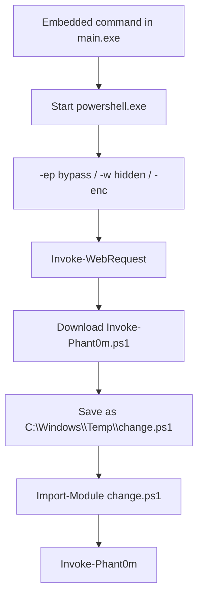

# Reverse Engineering - Another Injection

## Challenge Information

| Field | Details |
|---|---|
| Platform | Blue Team Labs Online (BTLO) |
| Category | Malware Analysis / Reverse Engineering |
| Challenge | Another Injection |
| Environment | Linux |
| Preparation Context | Blue Team Level 1 (BTL1) Exam Preparation |
| Evidence Screenshot | Screenshot_11.png |

## Overview

This challenge focuses on the static analysis of a Windows executable named `main.exe`. The investigation identifies the programming language, build identifier, Windows API dependency, target process, and commands embedded in the binary.

The analysis also examines a Base64-encoded PowerShell command to identify the file downloaded by the sample and the tool it attempts to execute.

The investigation is based on the original challenge notes and recorded command outputs. The original executable is not included in this repository.

## Investigation Objectives

- Identify the executable format and programming language.
- Extract the Go build ID.
- Identify the dependency used for Windows API calls.
- Determine the target process associated with process injection.
- Identify the process invoked by the embedded shellcode.
- Decode the recorded PowerShell command and identify the output file.
- Identify the tool referenced by the PowerShell command.

## Tools and Utilities

| Tool | Purpose |
|---|---|
| `file` | Identifies the executable file format and architecture. |
| `rabin2` | Inspects executable sections and helps identify Go-specific debugging information. |
| `strings` | Extracts readable strings, build identifiers, package names, process names, and embedded commands. |
| `grep` | Filters extracted strings for relevant indicators and keywords. |
| `base64` | Decodes the Base64-encoded PowerShell command. |
| `tr -d '\0'` | Removes null bytes from decoded UTF-16LE command output to make it readable. |
| CyberChef | Alternative tool for decoding Base64 and inspecting encoded data. |

## Evidence and Working Files

| File | Description |
|---|---|
| `main.exe` | Windows executable analyzed during the original BTLO challenge. |
| `Screenshot_11.png` | Screenshot retained as challenge evidence. |
| Original analysis notes | Source of the recorded commands, outputs, and challenge answers. |

The original `main.exe` binary is not included in this repository. Consequently, the recorded findings cannot be independently reproduced from the repository contents alone.

## Investigation Workflow

### Step 1 - Identify the Executable

The `file` utility identifies the executable format and architecture.

```bash
file main.exe
```

Recorded result: PE32+ Windows executable with 13 sections.

### Step 2 - Identify the Programming Language

The investigation searches for Go-specific debugging sections and the Go build identifier.

```bash
rabin2 -S main.exe | grep -i "zdebug"
strings main.exe | grep -i "go build"
```

Recorded findings:
- `.zdebug_*` sections were identified in the executable.
- A Go build ID was present in the extracted strings.

These findings support the identification of Golang as the programming language.

### Step 3 - Extract the Build ID

```bash
strings main.exe | grep -i "build id"
```

The command searches the executable for its embedded Go build identifier.

### Step 4 - Identify the Windows API Dependency

```bash
strings main.exe | grep -i "windows\|win32\|user32\|kernel32"
strings main.exe | grep -i "TheTitanrain"
strings main.exe | grep -E "^github\.com"
```

The extracted strings revealed the package `github.com/TheTitanrain/w32` and references to Windows API functions.

### Step 5 - Identify the Target Process

```bash
strings -n 6 main.exe | grep -iE "\.exe" | grep -v "go/src\|runtime\|syscall\|internal"
strings -n 6 main.exe | grep -iE "notepad|calc|mspaint|wordpad"
```

The investigation identified `notepad.exe` as the target process associated with the injection functionality.

### Step 6 - Identify the Process Invoked by the Shellcode

```bash
strings -n 6 main.exe | grep -i "powershell"
```

The extracted command contained PowerShell execution parameters including `-ep bypass`, `-w hidden`, and `-enc`.

This indicates an attempt to launch PowerShell with execution policy bypass, a hidden window, and an encoded command.

### Step 7 - Decode the Embedded PowerShell Command

The original analysis notes record the following decoding approach:

```bash
echo "BASE64_VALUE" | base64 -d | tr -d '\0'
```

The recorded decoded command contained an `Invoke-WebRequest` request to download `Invoke-Phant0m.ps1`, save it as `C:\Windows\Temp\change.ps1`, import the script, and invoke `Invoke-Phant0m`.

The original Base64 value in the available notes is truncated, so the complete decoding operation cannot be independently repeated using the repository contents.

The analysis was static. The executable and extracted PowerShell command were not executed as part of this documented workflow.

## Challenge Questions and Answers

### Q1. Which programming language was used to develop the executable?
**Answer:** Golang (Go).

**Evidence:** The executable contains Go-specific debug sections (`.zdebug_*`) and a Go build ID.

### Q2. What is the Go Build ID?
**Answer:**
```text
eck19EyXq_9c975RxNJ1/QkbhfvYWoTcAeJreFwhX/q3HwQW17YdD3iMlLFCzB/1ZpNy-9ah0QEvzlOTFcq
```

### Q3. Which Windows API dependency is referenced by the executable?
**Answer:** `github.com/TheTitanrain/w32`.

**Evidence:** Strings reference the package and Windows API modules such as `modkernel32`, `moduser32`, and `procSetWindowsHookEx`.

### Q4. Which process is targeted by the malware?
**Answer:** `notepad.exe`.

### Q5. Which process is invoked from the embedded shellcode command?
**Answer:** `powershell.exe`.

**Observed command-line options:** `-ep bypass`, `-w hidden`, and `-enc`.

### Q6. Which file is created by the embedded PowerShell command?
**Answer:** `C:\Windows\Temp\change.ps1`.

### Q7. Which tool is downloaded and invoked by the embedded command?
**Answer:** `Invoke-Phant0m`.

**Evidence:** The recorded decoded command downloads `Invoke-Phant0m.ps1` from its GitHub repository, saves it as `change.ps1`, imports the script, and invokes `Invoke-Phant0m`.

**Important note:** These answers are based on the recorded static-analysis findings. The original executable was not included in the repository, and the malware or embedded PowerShell command was not executed.

## Indicators and Technical Observables

| Type | Observed value | Analysis notes |
|---|---|---|
| Executable | `main.exe` | Windows PE32+ executable analyzed statically |
| Programming language | Golang (Go) | Supported by Go-specific sections and build ID |
| Go Build ID | `eck19EyXq_9c975RxNJ1/QkbhfvYWoTcAeJreFwhX/q3HwQW17YdD3iMlLFCzB/1ZpNy-9ah0QEvzlOTFcq` | Build identification string extracted from the binary |
| Go dependency | `github.com/TheTitanrain/w32` | Windows API wrapper dependency referenced in strings |
| Target process | `notepad.exe` | Process name identified during static analysis |
| Invoked process | `powershell.exe` | Embedded command references PowerShell with `-ep bypass`, `-w hidden`, and `-enc` |
| Download URL | `https://raw.githubusercontent.com/hlldz/Invoke-Phant0m/master/Invoke-Phant0m.ps1` | URL present in the recorded decoded command |
| File path | `C:\Windows\Temp\change.ps1` | Destination path specified in the embedded command |
| Tool | `Invoke-Phant0m` | PowerShell tool referenced by the embedded command |

**Interpretation note:** These values are static-analysis observables extracted from the available notes. They do not independently prove that the executable ran, that the file was created, that the URL was contacted, or that the referenced tool executed.

## Static Analysis Workflow

The following diagram summarizes the static-analysis process and the evidence extracted from the executable.



**Analysis boundary:** The diagram represents findings from static inspection. It does not represent confirmed process execution or successful payload deployment.

## Embedded PowerShell Command Analysis

The recorded decoded command indicates the following intended execution sequence:



**Security relevance:** The recorded command combines hidden PowerShell execution, execution-policy bypass parameters, a remote script download, and invocation of a PowerShell tool. These characteristics warrant investigation, but the available evidence does not confirm that any of these actions occurred on a victim system.


## Key Findings

1. The analyzed file was identified as a Windows PE32+ executable.
2. Go-specific debug sections and a Go Build ID indicate that the executable was developed using Golang.
3. The binary references the `github.com/TheTitanrain/w32` package and Windows API functionality.
4. Static string analysis identified `notepad.exe` as the target process.
5. An embedded command references `powershell.exe` with hidden execution, execution-policy bypass, and encoded-command parameters.
6. The recorded decoded command references downloading `Invoke-Phant0m.ps1` from GitHub and saving it to `C:\Windows\Temp\change.ps1`.
7. The command subsequently references importing the downloaded script and invoking `Invoke-Phant0m`.

## Limitations

- The original `main.exe` binary is not included in this repository.
- The complete Base64 command was not preserved in the available source notes; therefore, independent full decoding could not be repeated.
- Findings are based on recorded static-analysis output and notes.
- The executable and embedded PowerShell command were not executed.
- No runtime telemetry, process creation logs, network captures, or endpoint artifacts were provided to confirm execution.
- No conclusion is made about successful compromise, persistence, or actual impact on a victim system.

## Conclusion

Static analysis of `main.exe` identified characteristics consistent with a Golang Windows executable and revealed references to Windows API functionality, a target process (`notepad.exe`), and an embedded PowerShell command. The recorded command describes downloading and invoking `Invoke-Phant0m` through a script saved in the Windows Temp directory.

The combination of hidden PowerShell execution, execution-policy bypass parameters, encoded command content, and remote script retrieval represents suspicious behavior that would warrant further investigation in a real incident. However, because the original executable and runtime evidence were unavailable, the findings describe observed static indicators and intended command behavior only. They do not establish that the payload executed or that a system was compromised.

## Evidence Integrity

| Evidence item | SHA256 |
|---|---|
| Screenshot_11.png | `73A56448078DD3E7083C6429884679F3FD450C326241B76DDC716DDBC8855183` |

The screenshot hash was verified against the original source image after copying it into the challenge directory. The original executable was not included, so its hash could not be recorded or independently verified.
