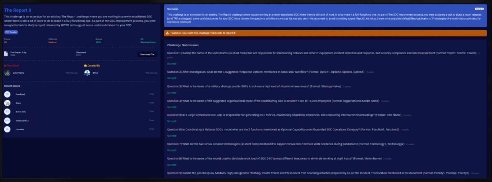
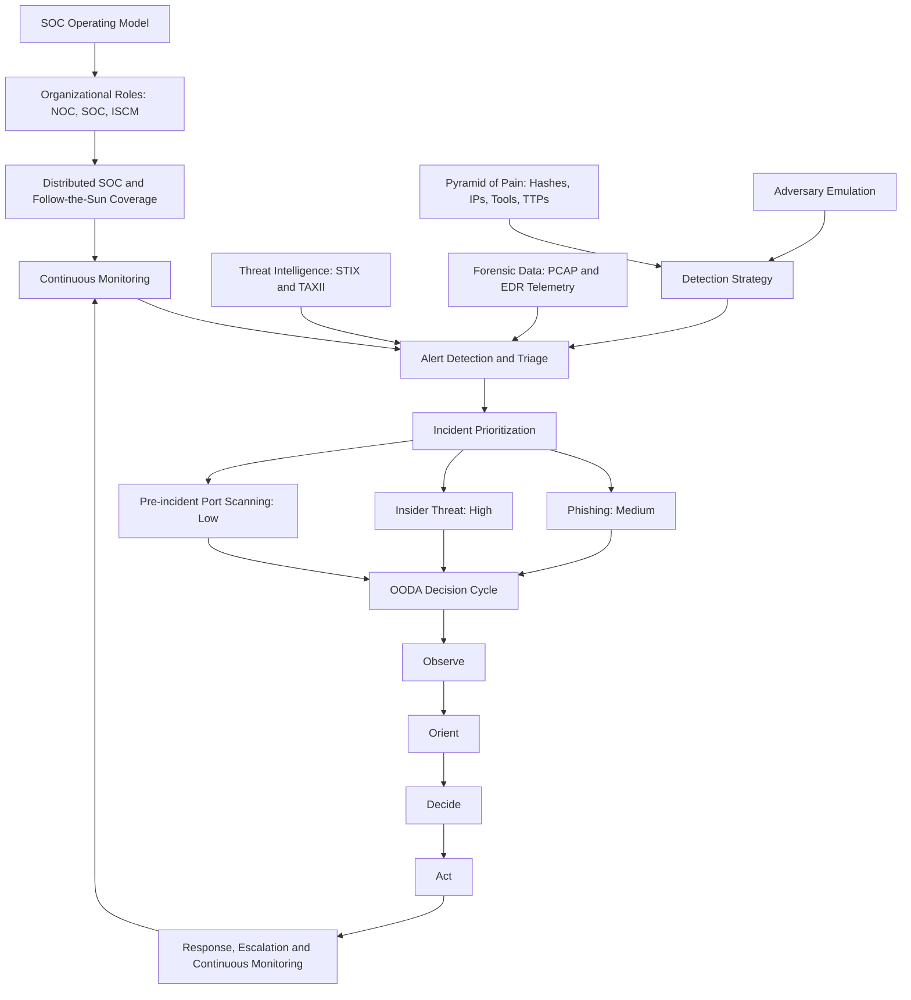

# The Report II

## Challenge Information

| Field | Details |
|---|---|
| Challenge | The Report II |
| Category | SOC Operations / SOC Strategy |
| Platform | Blue Team Labs Online (BTLO) |
| Completion Date | 2026-09-23 |
| Preparation Context | Blue Team Level 1 (BTL1) |

## Overview

The Report II is an extension of the original The Report challenge. It focuses on improving a newly established Security Operations Center (SOC) by examining organizational structures, operational processes, staffing models, threat intelligence, incident prioritization, and security monitoring capabilities.

The challenge references the MITRE publication *11 Strategies of a World-Class Cybersecurity Operations Center* and asks questions about applying SOC concepts in practical organizational scenarios.

This challenge is primarily knowledge-based. It does not represent a hands-on incident response investigation.

## Investigation Objectives

The main objectives were to identify and understand:

- The responsibilities of NOC, SOC, and ISCM teams.
- Basic SOC workflow response options.
- Situational awareness and decision-making models.
- SOC organizational structures and operational roles.
- Virtual console technologies and distributed SOC coverage.
- Incident prioritization.
- Mobile investigation operating systems.
- Open threat intelligence standards.
- High-volume forensic data sources.
- EDR data retention requirements.
- The Pyramid of Pain.
- Adversary emulation.

## Questions and Answers

The following answers are transcribed from the original challenge notes.

| No. | Question Topic | Answer |
|---:|---|---|
| 1 | Teams responsible for network operations, security operations, and security compliance/risk measurement | NOC, SOC, ISCM |
| 2 | Basic SOC workflow response options | Block activity, Deactivate account, Continuous watching, Refer to outside party |
| 3 | Military strategy used to achieve situational awareness | OODA |
| 4 | Suggested SOC organizational model for 1,000–10,000 employees | Distributed SOC |
| 5 | Role responsible for metrics, situational awareness, and training in a large centralized SOC | SOC Operations Lead |
| 6 | Optional capabilities under Expanded SOC Operations for Coordinating and National SOC models | Deception, Insider Threat |
| 7 | Virtual console technologies supporting Virtual SOC / Remote Work scenarios | iLO, iDRAC |
| 8 | Model used to distribute SOC workload across time zones for 24/7 coverage | Follow the Sun |
| 9 | Priorities for Phishing, Insider Threat, and Pre-incident Port Scanning | Medium, High, Low |
| 10 | Open-source operating system for mobile incident investigations | Santoku |
| 11 | Open threat intelligence standards | STIX, TAXII |
| 12 | Data source typically consuming the highest volume | PCAP |
| 13 | Recommended EDR data retention period for forensic purposes | 6 months |
| 14 | Pyramid of Pain indicators from Trivial to Tough | Hash values, IP addresses, Tools, TTPs |
| 15 | Red Team approach that mimics an adversary's TTPs | Adversary Emulation |

## Key Concepts

### SOC Organizational Structure

- **NOC (Network Operations Center):** Focuses on network availability, performance, and operational monitoring.
- **SOC (Security Operations Center):** Monitors, detects, investigates, and responds to security threats.
- **ISCM (Information Security Continuous Monitoring):** Supports continuous assessment of security controls and organizational risk.

A Distributed SOC model can provide security operations across multiple locations or organizational units.

### SOC Workflow and Incident Prioritization

SOC workflows involve monitoring, detection, analysis, response, escalation, and continuous observation.

The challenge notes identify the following prioritization:

- Phishing: Medium
- Insider Threat: High
- Pre-incident Port Scanning: Low

Prioritization should be understood in the context of organizational risk, available evidence, and potential impact.

### OODA Loop

OODA stands for:

1. Observe
2. Orient
3. Decide
4. Act

It is a decision-making cycle that supports situational awareness and timely action.

### Follow the Sun

The Follow the Sun model distributes operational responsibilities between teams in different time zones. This allows continuous SOC coverage without requiring the same team to work throughout the night.

### Virtual Console Technologies

- **iLO (Integrated Lights-Out):** HPE remote server management technology.
- **iDRAC (Integrated Dell Remote Access Controller):** Dell remote server management technology.

These technologies provide remote server administration and console access.

### Threat Intelligence Standards

- **STIX (Structured Threat Information Expression):** A standardized language for representing cyber threat intelligence.
- **TAXII (Trusted Automated Exchange of Intelligence Information):** A protocol for exchanging cyber threat intelligence.

### PCAP and EDR Data

PCAP files contain captured network traffic and can represent a substantial source of forensic data.

EDR telemetry supports endpoint investigation and incident reconstruction. The six-month retention period is the answer recorded in the challenge notes, not a universal retention requirement.

### Pyramid of Pain

The Pyramid of Pain describes the relative difficulty an adversary may experience when defenders detect and disrupt different indicators.

| Level | Indicator |
|---|---|
| Trivial | Hash values |
| Easy | IP addresses |
| Challenging | Tools |
| Tough | Tactics, Techniques, and Procedures (TTPs) |

Changing TTPs generally requires more effort from an adversary than changing individual indicators such as file hashes.

### Adversary Emulation

Adversary Emulation is a Red Team approach that reproduces known adversary tactics, techniques, and procedures to evaluate defensive capabilities.

It helps defenders assess detection coverage and identify gaps in security monitoring and response.

## Investigation Methodology

The challenge notes describe the following general approach:

1. Review the challenge questions and identify the relevant SOC concepts.
2. Consult the referenced MITRE publication.
3. Search the reference material for relevant terminology and organizational models.
4. Compare the question wording with the relevant concepts.
5. Record the answers in the requested format.
6. Review the completed answer set.

The original notes also mention using a PDF reader and text search to locate relevant sections.

## Evidence

The following evidence was preserved in the repository:

| Evidence | Description | SHA256 |
|---|---|---|
| Screenshot_20.png | Challenge introduction and questions from the first part | A0180D87D32F6D3F34350A9C6502F1DEDCE5E69B0C8B76C53E26ABDBD16DD064 |
| Screenshot_21.png | Continuation of the challenge questions | 6180546A991880941EF7FABFAE7417267DA8B999CCF40EEB07161DAB85BD3C53 |
| Original TXT notes | Saved challenge answers and study notes | 2FD3575A3C46EB21F42C79CBAB55144B69C8D5F042D58DF88E475A9FDA496691 |

### Screenshot Evidence

#### Screenshot 20

#### Screenshot 21

## Evidence Limitations

- The screenshots document the challenge introduction and visible question text.
- Questions 7, 8, and 9 appear in both screenshot OCR extracts.
- Question 5 and its recorded answer are present in the original TXT notes but were not reliably identified in the screenshot OCR.
- The screenshots do not independently establish that the recorded answers were submitted or accepted by the platform.
- The answer set is transcribed from the preserved notes and has not been independently validated against the original MITRE publication in this documentation.
- The six-month EDR retention period is a challenge answer and should not be interpreted as a universal operational standard.

## Learning Outcomes

This challenge reinforces several BTL1-relevant concepts:

- Understanding SOC roles and organizational models.
- Recognizing basic SOC workflow and incident prioritization.
- Applying the OODA decision-making cycle.
- Understanding continuous SOC coverage models.
- Recognizing remote server management technologies.
- Understanding STIX and TAXII.
- Identifying the forensic value and storage demands of PCAP data.
- Understanding endpoint telemetry retention.
- Applying the Pyramid of Pain.
- Distinguishing adversary emulation from other Red Team approaches.

## Conclusion

The Report II provides an overview of the organizational and technical considerations involved in establishing and improving a Security Operations Center.

Its main value for BTL1 preparation is the consolidation of SOC operations, incident prioritization, threat intelligence, forensic data sources, and adversary behavior concepts.

The preserved notes and screenshots provide a record of the challenge material and the answers documented during the original exercise.

---

*Documentation prepared as part of a practical DFIR and SOC learning portfolio for BTL1 examination preparation.*

## SOC Operations and Decision-Making Workflow

