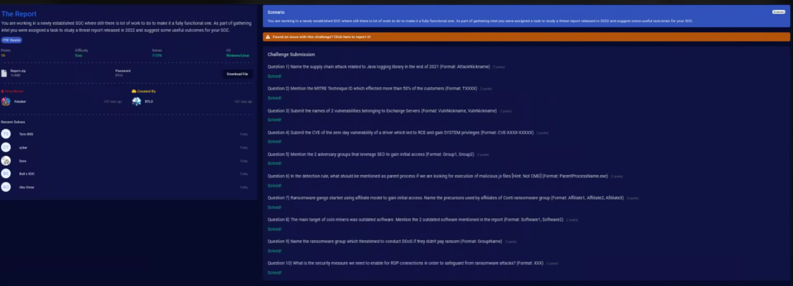
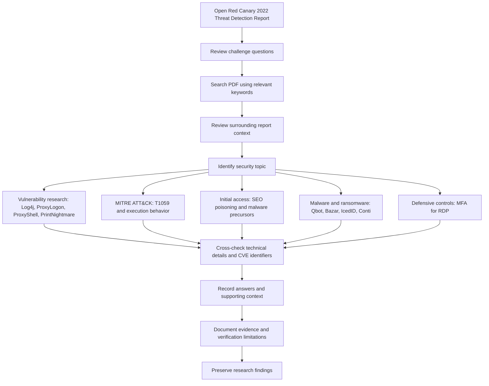

# The Report
## Challenge Information
- **Challenge:** The Report
- **Category:** Threat Intelligence / Threat Detection
- **Platform:** Blue Team Labs Online (BTLO)

## Overview

The Report is a knowledge-based challenge built around the Red Canary 2022 Threat Detection Report. It focuses on vulnerabilities, adversary groups, attack techniques, malware delivery methods, and defensive security measures.

The exercise involves reviewing threat intelligence material, searching a PDF document, and understanding the security concepts behind the answers. It is a research and knowledge-assessment exercise rather than a hands-on incident response investigation.

## Investigation Objectives

- Identify major vulnerabilities and their associated CVE identifiers.
- Understand MITRE ATT&CK techniques and attacker behavior.
- Identify adversary groups and their initial access methods.
- Recognize malware associated with ransomware operations.
- Understand attack techniques involving Windows processes.
- Identify defensive measures for securing remote access.

## Questions and Answers

The following answers are transcribed from the original challenge notes.

| No. | Question Topic | Answer |
|---:|---|---|
| 1 | Java logging library supply chain attack | Log4j |
| 2 | MITRE technique affecting more than 50% of customers | T1059 |
| 3 | Exchange Server vulnerabilities | ProxyLogon, ProxyShell |
| 4 | Zero-day driver vulnerability | CVE-2021-34527 (PrintNightmare) |
| 5 | Adversary groups using SEO for initial access | Gootkit, Yellow Cockatoo |
| 6 | Parent process for malicious JavaScript execution | wscript.exe |
| 7 | Initial access precursors associated with Conti affiliates | Qbot, Bazar, IcedID |
| 8 | Outdated software targeted by coin miners | JBoss, WebLogic |
| 9 | Ransomware group threatening DDoS attacks | Fancy Lazarus |
| 10 | Security measure for RDP connections | MFA |

## Key Concepts

### Log4j and Log4Shell
Log4Shell (CVE-2021-44228) affected vulnerable versions of Apache Log4j 2. Under vulnerable conditions, specially crafted log messages involving JNDI lookups could lead to remote code execution.

### MITRE ATT&CK T1059
T1059 represents Command and Scripting Interpreter. Attackers may abuse PowerShell, Windows Command Shell, and Unix Shell to execute malicious commands and scripts.

### ProxyLogon and ProxyShell
ProxyLogon and ProxyShell are vulnerability chains affecting Microsoft Exchange Server. They were associated with unauthorized access and remote code execution risks.

| Vulnerability | CVE |
|---|---|
| ProxyLogon | CVE-2021-26855 |
| ProxyShell | CVE-2021-34473, CVE-2021-34523, CVE-2021-31207 |

### PrintNightmare
CVE-2021-34527, known as PrintNightmare, affects the Windows Print Spooler service. Exploitation could allow code execution with elevated privileges, potentially including SYSTEM.

### SEO Poisoning
SEO poisoning manipulates search engine results to direct users to malicious websites. The challenge notes identify Gootkit and Yellow Cockatoo as groups associated with SEO-based initial access.

### Windows Script Host
wscript.exe is the Windows Script Host executable and can execute JavaScript and VBScript files. Its process activity, command-line arguments, parent process, and child processes can provide useful detection evidence.

### Conti Ransomware Affiliates
Qbot, Bazar, and IcedID are identified in the challenge notes as initial access precursors associated with Conti ransomware affiliates. This illustrates how separate malware operators and access brokers can contribute to ransomware operations.

### JBoss and WebLogic
JBoss and WebLogic are Java application server platforms. Outdated or exposed installations can be targeted and abused to deploy unauthorized workloads, including cryptocurrency miners.

### Fancy Lazarus and DDoS Extortion
The challenge notes identify Fancy Lazarus as a ransomware group that threatened DDoS attacks as an additional extortion method.

### Multi-Factor Authentication
MFA adds an additional authentication factor beyond a password. Enabling MFA for RDP access helps reduce the risk of unauthorized access through compromised credentials.

## Investigation Methodology

1. Download the challenge reference archive (report.zip).
2. Extract the archive using the supplied password: BTLO.
3. Open the Red Canary 2022 Threat Detection Report in a browser or PDF reader.
4. Review each question and identify the relevant security topic.
5. Use PDF text search (Ctrl+F) with relevant keywords.
6. Review the surrounding report content to understand the context.
7. Research relevant CVEs and security concepts when additional clarification is required.
8. Record and review the answers.

## Tools Used

| Tool | Purpose |
|---|---|
| Web Browser / PDF Reader | Open and review the Red Canary report |
| Ctrl+F | Search for relevant terms within the PDF |
| Google Search | Research CVEs and clarify security concepts |
| MITRE ATT&CK | Understand T1059 and its context |

No command-line forensic tools were required for this knowledge-based challenge.

## Evidence

The following evidence was preserved during the exercise:

| Evidence | Description | SHA256 |
|---|---|---|
| Screenshot_2.png | Screenshot of The Report challenge | A6CB2A4789CD03DE10D5B4D1C2302E2A589DB9E4DB4CB00DF16325714540F185 |
| Original TXT notes | Saved challenge answers and research notes | AD71A95862A0E1CD7B318A06EAD680642C2636176C3158641B0CC033DB8E31EF |

### Screenshot Evidence

The original TXT notes were used as the source for the recorded answers. The SHA256 value identifies the original notes file.

## Evidence Limitations

- The screenshot documents the preserved challenge material.
- The original Red Canary PDF report was referenced in the notes but was not preserved in this repository evidence set.
- The SHA256 value for the TXT notes identifies the original source file; the notes themselves are not included in the challenge directory.
- The answers are transcribed from the preserved notes and have not been independently validated against the original PDF.
- The available evidence does not independently establish that the answers were accepted by the BTLO platform.
- The identification of wscript.exe is a detection clue from the challenge notes, not a universal parent-process rule.

## Learning Outcomes

- Practiced reviewing threat intelligence reports and extracting relevant security information.
- Improved PDF text-search and research skills.
- Reviewed vulnerabilities and associated CVE identifiers.
- Studied MITRE ATT&CK technique T1059.
- Examined malware, initial access methods, and ransomware activity.
- Reviewed MFA as a security control for remote access.

## Conclusion

The Report provided practical experience in threat intelligence research using a published threat detection report. The exercise covered vulnerabilities, adversary techniques, malware, ransomware activity, and defensive controls.

The preserved screenshot and challenge notes document the work performed. The answers remain subject to independent verification against the original Red Canary report.

This challenge contributes to preparation for the Blue Team Level 1 (BTL1) certification by strengthening foundational threat intelligence and security research skills.

## Threat Intelligence Research Workflow

